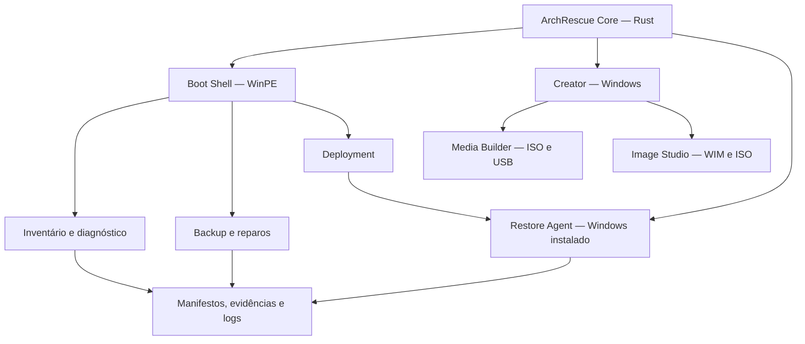

# ArchRescue — Roadmap Mestre

> **Projeto brasileiro, gratuito e open-source.** Este documento é o espelho offline editável do planejamento importado para o ClickUp. Ele não substitui a verificação do estado real do ClickUp quando a integração estiver disponível.
>
> **Data de referência:** 08/11/2026 • **Versão do documento:** 1.0.0 • **Estado do projeto:** planejamento • **Próxima decisão:** definição formal do MVP.

## 1. Escopo e fonte de verdade

- **Produto:** ArchRescue, plataforma de recuperação, manutenção, backup, migração e implantação do Windows, de origem brasileira, gratuita e open-source.
- **Distribuição A — ArchRescue Boot ISO:** ambiente inicializável, pensado para hardware físico e VMs, com painel de recuperação.
- **Distribuição B — ArchRescue Creator:** aplicativo para Windows que cria e atualiza pendrives de recuperação e pode produzir mídias personalizadas.
- **Componentes compartilhados:** ArchRescue Core (proposta em Rust), Image Studio (importação/customização de imagens Windows) e Restore Agent (fase pós-instalação).
- **ClickUp de referência:** [Desenvolvimento → ArchRescue](https://app.clickup.com/90171344329/v/f/1600600000000048/90176222943).
- **Identificadores de localização:** workspace `90171344329`, espaço `90176222943`, pasta `1600600000000048`, lista `1600600000000050` (`List`).
- **Baseline importado:** 17 épicos + 158 subtarefas = **175 itens**. Quantidades verificadas no CSV original, não na lista remota.
- **Estado remoto:** a pessoa responsável informou que concluiu a importação; **IDs reais e estados das tarefas ainda não foram validados pela API**.
- **Extensões posteriores à importação:** AR-17 e AR-18 são **propostas locais NÃO sincronizadas** (veja seção 11); não aparecem no CSV original.

### 1.1. Regras de atualização e precedência

1. **Com ClickUp acessível:** conferir IDs e status das tarefas antes de alterar este arquivo; registrar `SYNC` no diário. ClickUp é a referência operacional compartilhada.
2. **Sem ClickUp:** atualizar **este arquivo** como fonte operacional temporária. Cada mudança de estado precisa de evidência, data e linha no diário de alterações.
3. **Ao reconectar:** reconciliar por código estável (ex.: `AR-04-03`) + título, nunca por número sequencial da planilha. O `Task ID` numérico do CSV foi uma referência de importação e **não é** o ID definitivo da tarefa do ClickUp.
4. **Conflitos:** não sobrescrever status `CONCLUÍDO` ou descrições alteradas remotamente sem inspeção. Registrar decisão de merge no histórico.
5. **Sem falso progresso:** todos os itens começam como `BACKLOG` neste primeiro snapshot porque não há evidência verificada de execução. Isso **não prova** que estejam pendentes no ClickUp.
6. **Propostas novas:** somente adicionar ao ClickUp após verificar que ainda não existem, evitando duplicatas.

### 1.2. Convenção de status e evidências

| Estado | Significado | Como registrar |
|---|---|---|
| `BACKLOG` | Catalogado, ainda não iniciado neste espelho | Caixa `[ ]`; sem evidência de execução |
| `PRONTO` | Refinado, critérios e dependências claros | Motivo, responsável se houver |
| `EM_ANDAMENTO` | Execução comprovada | Branch/PR, logs ou referência de trabalho |
| `BLOQUEADO` | Não pode avançar | Bloqueio explícito, quem resolve, próximo passo |
| `EM_QA` | Implementado, aguardando verificação | Link para testes e evidências |
| `CONCLUÍDO` | Critérios aceitos com provas | Caixa `[x]`, data, evidência, resultado |
| `CANCELADO` | Retirado do escopo | Justificativa, decisão, impacto e data |

**Importante:** marcar `[x]` apenas quando houver evidência suficiente; os checkboxes de critérios de aceite podem ser marcados separadamente e não implicam que a tarefa foi concluída. Nenhuma data ou responsável foi inventado.

## 2. Visão de execução por estágios

| Estágio | Objetivo | Entrega de saída | Condição para seguir |
|---|---|---|---|
| M0 — Fundação | Requisitos, arquitetura, segurança e viabilidade jurídica | ADRs, modelo de ameaça, decisão de escopo | Riscos críticos conhecidos e aprovados |
| M1 — Primeiro boot | ISO x64 UEFI, shell, UI, inventário de discos | ArchRescue inicializando em laboratório | Boot e leitura segura aprovados |
| M2 — Reparo | Diagnóstico/repair engine baseado em evidências | Reparos controlados e verificáveis | Regressão em VMs e tratamento de risco |
| M3 — Proteção dos dados | Explorador, backup seletivo, manifesto, integridade | Backup recuperável e conferido | Nenhum wipe sem pré-condições atendidas |
| M4 — Deployment | Instalação limpa com origem ISO/WIM | Instalação reproduzível de Windows | Identidade do disco/consentimento/testes E2E |
| M5 — Restauração | Restore Agent, perfis, apps e drivers | Migração e validação pós-instalação | Compatibilidade e evidências do restore |
| Creator | Gravar/atualizar mídias e gerenciar conteúdo | Aplicativo Creator para Windows | ISO base estável e mídia verificada |
| Studio | Importar/inspecionar/gerar imagens personalizadas | Image Studio, ISO original preservada | Build assinado/testado e licenças avaliadas |
| Transversal | QA, supply chain, documentação, licenças | Gates contínuos | Não liberar sem aprovação |
| Post-MVP | Plugins, IA opcional, recuperação avançada e legado | RFCs e protótipos | A definir em versões futuras |

> **As fases acima são o planejamento original, não um compromisso de datas.** O limite entre MVP e versões posteriores ainda será aprovado. A ordem de Creator e Studio poderá mudar após a definição do MVP.

## 3. Marcos, dependências e gates

### 3.1. Dependências técnicas principais

| Item | Depende de | Observação |
|---|---|---|
| AR-01 (Boot ISO) | AR-00; parte de AR-12/AR-13 | Confirmar solução de build e distribuição do WinPE |
| AR-02 (Painel) | AR-01 runtime e shell | Interface deve funcionar de fato no WinPE |
| AR-03 (Inventário) | AR-01 | Leitura de discos estável antes de operações que alteram dados |
| AR-04 (Reparo) | AR-03 e políticas AR-12 | Nunca executar mudanças sem pré-checagem e plano explícito |
| AR-05 (Backup) | AR-03 e controles AR-12 | Destino validado; cópia verificável |
| AR-06 (Implantação) | AR-03, AR-05, AR-12 e AR-13 | Preservação e confirmação antes de formatar |
| AR-07 (Restore Agent) | AR-05 e AR-06 | Desenho de dados e retomada seguros |
| AR-08 (Apps/drivers) | AR-03, AR-06/AR-07 e AR-13 | Drivers compatíveis; licenças de instaladores |
| AR-10 (Creator) | AR-01, AR-03 e AR-12 | Aproveitar o boot validado; cuidado com disco escolhido |
| AR-09 (Image Studio) | AR-06, AR-12 e AR-13 | ISO original imutável, ambiente de trabalho isolado |
| AR-14/AR-15 (QA/docs) | Transversais | Não deixar para o fim |
| AR-17/AR-18 (propostas) | M0 | Open source/benchmark são requisitos de produto, não meras divulgações |

### 3.2. Gates de aprovação

- [ ] **G0 — MVP aprovado:** definir o primeiro cenário de valor, entregas incluídas, exclusões, requisitos mínimos e DoD.
- [ ] **G1 — Distribuição viável:** parecer sobre WinPE/ADK e estratégia de distribuição compatível com software open-source.
- [ ] **G2 — Segurança de disco:** identidade forte, seleção confirmada, operação dry-run, proteção de mídia e testes contra escrita errada.
- [ ] **G3 — Boot comprovado:** ISO inicia em pelo menos duas configurações representativas de VM e em hardware de teste (conforme matriz aprovada).
- [ ] **G4 — Recuperação/backup comprovados:** cenários controlados, hashes/manifesto, logs e falhas simuladas.
- [ ] **G5 — Publicação:** CI, hashes, SBOM, documentação, licença validada, release notes e resultados de QA.

## 4. Definição de pronto (DoD) global

Uma tarefa só pode ser marcada como `CONCLUÍDO` quando: (a) o comportamento planejado foi implementado; (b) os critérios de aceite específicos foram cumpridos; (c) testes positivos/negativos e evidências foram anexados ou referenciados; (d) documentação e riscos foram atualizados; (e) alterações destrutivas receberam testes adicionais e revisão; (f) o status foi conciliado com ClickUp quando disponível. Para estudos/ADRs, basta documento aprovado e evidência de revisão — não código.

## 5. Próxima atividade prioritária: definir o MVP

**Status:** `NÃO DEFINIDO / PRÓXIMA SESSÃO` • **Item de referência:** AR-00-02 (CSV #3).

A próxima etapa **não será codificar nem assumir antecipadamente escopo de MVP**. Ela deve produzir uma especificação aprovada com:

- [ ] Persona e problema de referência: técnico, usuário final ou ambos.
- [ ] Jornada principal mínima: por exemplo, identificar instalação e diagnosticar boot, ou preservar dados — **exemplo, ainda não decisão**.
- [ ] Compatibilidade inicial: x64/UEFI, VMs alvo e seleção de hardware real.
- [ ] Base de boot/distribuição: WinPE, alternativa livre ou arquitetura híbrida; requisitos legais.
- [ ] Funcionalidades imprescindíveis e exclusões explícitas do MVP.
- [ ] Limites de operações destrutivas: somente leitura, reparo assistido e/ou backup em primeira versão.
- [ ] Testes de aceite E2E; critérios para demonstrar valor real.
- [ ] Estrutura de repositório, versão-alvo, release inicial, manutenção e suporte.
- [ ] Critérios para publicação do código e de possíveis imagens binárias, sem redistribuição indevida.

**Saída esperada:** ADR/RFC `MVP-001`, lista priorizada de tarefas incluídas e excluídas, dependências e `G0` aprovado. Não atribuir prazos antes dessa decisão.

## 6. Arquitetura-alvo (proposta sujeita a ADR)



**Contratos candidatos:** `OperationPlan`, `DiskIdentity`, `BackupManifest`, `ISOManifest`, `RepairStep`, `Evidence`, `Result`. Empregar schemas versionados, validação estrita e checkpoints. Comunicação JSON nas bordas quando útil; implementação interna livre para modelos tipados e formatos eficientes. Não utilizar IA como autoridade final para escrever em discos.

## 7. Princípios invioláveis

1. **Privacidade:** execução offline primeiro, telemetria facultativa e sem coleta silenciosa de credenciais.
2. **Preservação:** nunca presumir que arquivos estão salvos sem backup e validação; nenhuma formatação sem consentimento.
3. **Discos degradados:** minimizar escritas e leituras agressivas; privilegiar imagem/cópia apropriada, se possível.
4. **BitLocker:** somente desbloqueio autorizado; não prometer contorno de criptografia ou recuperação de senhas.
5. **Drivers:** exportar e restaurar apenas pacotes compatíveis, confiáveis e quando possível assinados.
6. **Apps:** instaladores reais após implantação; copiar Program Files não é migração universal. Licenças e dados protegidos exigem tratamento específico.
7. **ISOs externas:** preservar a original, validar hash/origem, isolar build e não confiar em personalizações desconhecidas.
8. **Secure Boot:** suportar cadeia aprovada, sem pedir desativação como solução padrão.
9. **Open source verdadeiro:** publicar código próprio sob licença reconhecida; WinPE/Windows e terceiros continuam sujeitos a licenças próprias.
10. **Brasil primeiro:** pt-BR como idioma principal, documentação bilíngue progressiva, comunidade aberta, sem paywall funcional.

## 8. Backlog integral importado — 17 épicos e 158 subtarefas

**Legenda:** todos os checkboxes estão desmarcados no snapshot inicial. IDs `AR-xx-yy` são estáveis **locais** criados a partir da ordem no CSV; o título original e o ID numérico de importação são mantidos. Este arquivo contém o escopo e os critérios de aceite originais, sem resumir as subtarefas.


### AR-00 — Governança, requisitos e arquitetura

- **Fase:** `M0` • **Prioridade de importação:** Alta • **ID CSV do épico:** `1` • **Subtarefas:** 9

- **Status local:** `BACKLOG` • **ClickUp:** importação informada, validação remota pendente

- [ ] **Épico concluído e validado** (marcar apenas quando subtarefas, critérios e evidências estiverem completos)

**Objetivo:** Estabelecer um desenho verificável antes de implementar ferramentas que tocam em dados de clientes.

**Subtarefas:**


#### AR-00-01 — Definir requisitos funcionais e perfis de uso

- [ ] **Concluída** | **Status:** `BACKLOG` | **Prioridade:** Alta | **ID CSV:** `2` | **ClickUp ID real:** `não vinculado`

**Objetivo e escopo**
Especificar modos Assistido, Técnico e Laboratório, persona de técnico e usuário leigo, operações permitidas por modo.

**Critérios de aceite**
- Documento versionado com jornadas principais, entradas, saídas e fluxos de erro.
- Registrar testes, logs/evidências e limitações de compatibilidade relevantes.

**Notas de implementação**
- Tratar falhas e pré-condições explicitamente.
- Reaproveitar contratos e componentes compartilhados do ArchRescue Core.


#### AR-00-02 — Formalizar limites do MVP e roadmap M0–M6

- [ ] **Concluída** | **Status:** `BACKLOG` | **Prioridade:** Alta | **ID CSV:** `3` | **ClickUp ID real:** `não vinculado`

**Objetivo e escopo**
Separar o que entra no primeiro Boot ISO, no Creator e no Image Studio, deixando recursos avançados para versões posteriores.

**Critérios de aceite**
- Escopo com itens incluídos/excluídos, dependências e marcos de aprovação.
- Registrar testes, logs/evidências e limitações de compatibilidade relevantes.

**Notas de implementação**
- Tratar falhas e pré-condições explicitamente.
- Reaproveitar contratos e componentes compartilhados do ArchRescue Core.


#### AR-00-03 — Elaborar ADR de arquitetura Rust + WinPE + agente pós-instalação

- [ ] **Concluída** | **Status:** `BACKLOG` | **Prioridade:** Alta | **ID CSV:** `4` | **ClickUp ID real:** `não vinculado`

**Objetivo e escopo**
Especificar crates compartilhadas, processos privilegiados, UI do WinPE, aplicação Creator e Restore Agent.

**Critérios de aceite**
- Diagrama de componentes, fronteiras de confiança e ADR aceito.
- Registrar testes, logs/evidências e limitações de compatibilidade relevantes.

**Notas de implementação**
- Tratar falhas e pré-condições explicitamente.
- Reaproveitar contratos e componentes compartilhados do ArchRescue Core.


#### AR-00-04 — Definir contratos de dados e modelo de execução

- [ ] **Concluída** | **Status:** `BACKLOG` | **Prioridade:** Alta | **ID CSV:** `5` | **ClickUp ID real:** `não vinculado`

**Objetivo e escopo**
Modelar OperationPlan, DiskIdentity, BackupManifest, ISOManifest, RepairStep, Evidence e Result, com versões de schema.

**Critérios de aceite**
- Schemas versionados, exemplos válidos e política de compatibilidade.
- Registrar testes, logs/evidências e limitações de compatibilidade relevantes.

**Notas de implementação**
- Tratar falhas e pré-condições explicitamente.
- Reaproveitar contratos e componentes compartilhados do ArchRescue Core.


#### AR-00-05 — Definir estados de operação, cancelamento e retomada

- [ ] **Concluída** | **Status:** `BACKLOG` | **Prioridade:** Alta | **ID CSV:** `6` | **ClickUp ID real:** `não vinculado`

**Objetivo e escopo**
Modelar pending/running/waiting/verified/failed/rolled_back, idempotência e checkpoints persistidos em volume seguro.

**Critérios de aceite**
- Máquina de estados testada contra interrupção, repetição e recuperação.
- Registrar testes, logs/evidências e limitações de compatibilidade relevantes.

**Notas de implementação**
- Tratar falhas e pré-condições explicitamente.
- Reaproveitar contratos e componentes compartilhados do ArchRescue Core.


#### AR-00-06 — Definir política de mudanças destrutivas e consentimento

- [ ] **Concluída** | **Status:** `BACKLOG` | **Prioridade:** Alta | **ID CSV:** `7` | **ClickUp ID real:** `não vinculado`

**Objetivo e escopo**
Estabelecer confirmação explícita para formatação, escrita em partições, reparos não reversíveis e perda potencial de dados.

**Critérios de aceite**
- Matriz de risco e fluxos de consentimento com alvo físico identificado.
- Registrar testes, logs/evidências e limitações de compatibilidade relevantes.

**Notas de implementação**
- Tratar falhas e pré-condições explicitamente.
- Reaproveitar contratos e componentes compartilhados do ArchRescue Core.


#### AR-00-07 — Criar padrões de documentação, nomenclatura e versionamento

- [ ] **Concluída** | **Status:** `BACKLOG` | **Prioridade:** Normal | **ID CSV:** `8` | **ClickUp ID real:** `não vinculado`

**Objetivo e escopo**
Padronizar estrutura do repo, convenções de código, semver, changelog, ADR, runbooks e nomenclatura de artefatos.

**Critérios de aceite**
- Padrões documentados e templates reutilizáveis no repositório.
- Registrar testes, logs/evidências e limitações de compatibilidade relevantes.

**Notas de implementação**
- Tratar falhas e pré-condições explicitamente.
- Reaproveitar contratos e componentes compartilhados do ArchRescue Core.


#### AR-00-08 — Definir compatibilidade e suporte por hardware/firmware

- [ ] **Concluída** | **Status:** `BACKLOG` | **Prioridade:** Alta | **ID CSV:** `9` | **ClickUp ID real:** `não vinculado`

**Objetivo e escopo**
Matriz x64/UEFI/Secure Boot; definir BIOS legado como extensão sujeita a testes; VM Hyper-V, VirtualBox, VMware, QEMU.

**Critérios de aceite**
- Matriz publicada com ambientes suportados, parciais e não suportados.
- Registrar testes, logs/evidências e limitações de compatibilidade relevantes.

**Notas de implementação**
- Tratar falhas e pré-condições explicitamente.
- Reaproveitar contratos e componentes compartilhados do ArchRescue Core.


#### AR-00-09 — Criar modelo de ameaças e plano de privacidade

- [ ] **Concluída** | **Status:** `BACKLOG` | **Prioridade:** Alta | **ID CSV:** `10` | **ClickUp ID real:** `não vinculado`

**Objetivo e escopo**
Listar ameaças a dados de clientes, mídia removível, ISO adulterada, execução de binários e credenciais.

**Critérios de aceite**
- Threat model e mitigações priorizadas, com testes associados.
- Registrar testes, logs/evidências e limitações de compatibilidade relevantes.

**Notas de implementação**
- Tratar falhas e pré-condições explicitamente.
- Reaproveitar contratos e componentes compartilhados do ArchRescue Core.


### AR-01 — Build, inicialização e ambiente WinPE

- **Fase:** `M1` • **Prioridade de importação:** Alta • **ID CSV do épico:** `11` • **Subtarefas:** 9

- **Status local:** `BACKLOG` • **ClickUp:** importação informada, validação remota pendente

- [ ] **Épico concluído e validado** (marcar apenas quando subtarefas, critérios e evidências estiverem completos)

**Objetivo:** Entregar a primeira ISO do ArchRescue, com boot reproduzível e ambiente estável.

**Subtarefas:**


#### AR-01-01 — Provisionar pipeline ADK + WinPE add-on

- [ ] **Concluída** | **Status:** `BACKLOG` | **Prioridade:** Alta | **ID CSV:** `12` | **ClickUp ID real:** `não vinculado`

**Objetivo e escopo**
Documentar versões suportadas e construir ambiente reproduzível de build em Windows.

**Critérios de aceite**
- Build limpo com dependências fixadas, log e hashes.
- Registrar testes, logs/evidências e limitações de compatibilidade relevantes.

**Notas de implementação**
- Tratar falhas e pré-condições explicitamente.
- Reaproveitar contratos e componentes compartilhados do ArchRescue Core.


#### AR-01-02 — Gerar ISO inicializável x64 UEFI

- [ ] **Concluída** | **Status:** `BACKLOG` | **Prioridade:** Alta | **ID CSV:** `13` | **ClickUp ID real:** `não vinculado`

**Objetivo e escopo**
Personalizar boot.wim e gerar mídia ISO com MakeWinPEMedia ou equivalente compatível.

**Critérios de aceite**
- Boot funcional em VM e bare metal UEFI, sem prompt obrigatório.
- Registrar testes, logs/evidências e limitações de compatibilidade relevantes.

**Notas de implementação**
- Tratar falhas e pré-condições explicitamente.
- Reaproveitar contratos e componentes compartilhados do ArchRescue Core.


#### AR-01-03 — Integrar bootstrap do ArchRescue no WinPE

- [ ] **Concluída** | **Status:** `BACKLOG` | **Prioridade:** Alta | **ID CSV:** `14` | **ClickUp ID real:** `não vinculado`

**Objetivo e escopo**
Substituir shell inicial por launcher com detecção de erros e fallback técnico.

**Critérios de aceite**
- Aplicação abre após boot; falha permite diagnóstico e recuperação.
- Registrar testes, logs/evidências e limitações de compatibilidade relevantes.

**Notas de implementação**
- Tratar falhas e pré-condições explicitamente.
- Reaproveitar contratos e componentes compartilhados do ArchRescue Core.


#### AR-01-04 — Validar componentes opcionais necessários do WinPE

- [ ] **Concluída** | **Status:** `BACKLOG` | **Prioridade:** Normal | **ID CSV:** `15` | **ClickUp ID real:** `não vinculado`

**Objetivo e escopo**
Identificar pacotes para rede, armazenamento, scripting e dependências concretas da UI.

**Critérios de aceite**
- Lista mínima de pacotes; testes que demonstram por que cada um é necessário.
- Registrar testes, logs/evidências e limitações de compatibilidade relevantes.

**Notas de implementação**
- Tratar falhas e pré-condições explicitamente.
- Reaproveitar contratos e componentes compartilhados do ArchRescue Core.


#### AR-01-05 — Implementar runtime Rust compatível com WinPE

- [ ] **Concluída** | **Status:** `BACKLOG` | **Prioridade:** Alta | **ID CSV:** `16` | **ClickUp ID real:** `não vinculado`

**Objetivo e escopo**
Gerar executáveis x64, empacotar DLLs necessárias e validar ausência de dependências indisponíveis.

**Critérios de aceite**
- Aplicação abre em WinPE limpo; dependências e licenças documentadas.
- Registrar testes, logs/evidências e limitações de compatibilidade relevantes.

**Notas de implementação**
- Tratar falhas e pré-condições explicitamente.
- Reaproveitar contratos e componentes compartilhados do ArchRescue Core.


#### AR-01-06 — Implementar localização da mídia e volumes após boot

- [ ] **Concluída** | **Status:** `BACKLOG` | **Prioridade:** Alta | **ID CSV:** `17` | **ClickUp ID real:** `não vinculado`

**Objetivo e escopo**
Descobrir onde estão imagens, ferramentas, planos e a partição de dados, independentemente da letra de unidade.

**Critérios de aceite**
- USB e ISO de VM mapeados por identidade, sem caminhos rígidos.
- Registrar testes, logs/evidências e limitações de compatibilidade relevantes.

**Notas de implementação**
- Tratar falhas e pré-condições explicitamente.
- Reaproveitar contratos e componentes compartilhados do ArchRescue Core.


#### AR-01-07 — Adicionar recuperação de shell e modo diagnóstico

- [ ] **Concluída** | **Status:** `BACKLOG` | **Prioridade:** Normal | **ID CSV:** `18` | **ClickUp ID real:** `não vinculado`

**Objetivo e escopo**
Habilitar console controlado quando interface falhar, com exportação de logs para mídia externa.

**Critérios de aceite**
- Fallback testado em falha intencional da UI.
- Registrar testes, logs/evidências e limitações de compatibilidade relevantes.

**Notas de implementação**
- Tratar falhas e pré-condições explicitamente.
- Reaproveitar contratos e componentes compartilhados do ArchRescue Core.


#### AR-01-08 — Montar suíte de testes de boot para VM

- [ ] **Concluída** | **Status:** `BACKLOG` | **Prioridade:** Alta | **ID CSV:** `19` | **ClickUp ID real:** `não vinculado`

**Objetivo e escopo**
Automatizar smoke tests em QEMU/Hyper-V quando disponíveis, validando tela inicial e acesso à mídia.

**Critérios de aceite**
- Logs e capturas de boot reproduzíveis em pelo menos duas VMs.
- Registrar testes, logs/evidências e limitações de compatibilidade relevantes.

**Notas de implementação**
- Tratar falhas e pré-condições explicitamente.
- Reaproveitar contratos e componentes compartilhados do ArchRescue Core.


#### AR-01-09 — Verificar assinatura e cadeia de inicialização UEFI

- [ ] **Concluída** | **Status:** `BACKLOG` | **Prioridade:** Alta | **ID CSV:** `20` | **ClickUp ID real:** `não vinculado`

**Objetivo e escopo**
Estabelecer cadeia compatível com Secure Boot e certificados atuais, sem desabilitação automática.

**Critérios de aceite**
- Boot de teste com Secure Boot habilitado em ambiente suportado.
- Registrar testes, logs/evidências e limitações de compatibilidade relevantes.

**Notas de implementação**
- Tratar falhas e pré-condições explicitamente.
- Reaproveitar contratos e componentes compartilhados do ArchRescue Core.


### AR-02 — Painel Boot ISO e experiência do usuário

- **Fase:** `M1` • **Prioridade de importação:** Alta • **ID CSV do épico:** `21` • **Subtarefas:** 9

- **Status local:** `BACKLOG` • **ClickUp:** importação informada, validação remota pendente

- [ ] **Épico concluído e validado** (marcar apenas quando subtarefas, critérios e evidências estiverem completos)

**Objetivo:** Painel utilizável por técnicos e usuários assistidos sem depender do terminal.

**Subtarefas:**


#### AR-02-01 — Definir design system do painel ArchRescue

- [ ] **Concluída** | **Status:** `BACKLOG` | **Prioridade:** Alta | **ID CSV:** `22` | **ClickUp ID real:** `não vinculado`

**Objetivo e escopo**
Desenvolver interface escura, tipografia, ícones, grids, estados e modos de alto contraste.

**Critérios de aceite**
- Biblioteca visual e guia de componentes aprovados.
- Registrar testes, logs/evidências e limitações de compatibilidade relevantes.

**Notas de implementação**
- Tratar falhas e pré-condições explicitamente.
- Reaproveitar contratos e componentes compartilhados do ArchRescue Core.


#### AR-02-02 — Implementar dashboard inicial de diagnóstico

- [ ] **Concluída** | **Status:** `BACKLOG` | **Prioridade:** Alta | **ID CSV:** `23` | **ClickUp ID real:** `não vinculado`

**Objetivo e escopo**
Mostrar sistemas instalados, discos, capacidade, alertas, criptografia e próximos passos.

**Critérios de aceite**
- Dados exibidos refletem detecção real; mensagens de risco claras.
- Registrar testes, logs/evidências e limitações de compatibilidade relevantes.

**Notas de implementação**
- Tratar falhas e pré-condições explicitamente.
- Reaproveitar contratos e componentes compartilhados do ArchRescue Core.


#### AR-02-03 — Criar navegação por oito categorias de utilidades

- [ ] **Concluída** | **Status:** `BACKLOG` | **Prioridade:** Normal | **ID CSV:** `24` | **ClickUp ID real:** `não vinculado`

**Objetivo e escopo**
Recuperação, Instalação, Discos, Backup, Hardware, Ferramentas, Rede, Aplicativos/Relatórios.

**Critérios de aceite**
- Todas as categorias acessíveis com navegação consistente.
- Registrar testes, logs/evidências e limitações de compatibilidade relevantes.

**Notas de implementação**
- Tratar falhas e pré-condições explicitamente.
- Reaproveitar contratos e componentes compartilhados do ArchRescue Core.


#### AR-02-04 — Implementar assistente de recuperação orientado por etapas

- [ ] **Concluída** | **Status:** `BACKLOG` | **Prioridade:** Alta | **ID CSV:** `25` | **ClickUp ID real:** `não vinculado`

**Objetivo e escopo**
Wizard Detectar → Diagnosticar → Reparar → Backup → Instalar → Restaurar → Validar.

**Critérios de aceite**
- Usuário vê etapa atual, ação seguinte, cancelamento e retorno seguro.
- Registrar testes, logs/evidências e limitações de compatibilidade relevantes.

**Notas de implementação**
- Tratar falhas e pré-condições explicitamente.
- Reaproveitar contratos e componentes compartilhados do ArchRescue Core.


#### AR-02-05 — Desenvolver modo Técnico avançado

- [ ] **Concluída** | **Status:** `BACKLOG` | **Prioridade:** Alta | **ID CSV:** `26` | **ClickUp ID real:** `não vinculado`

**Objetivo e escopo**
Expor parâmetros, evidências, comandos gerados e logs sem executar ações silenciosas.

**Critérios de aceite**
- Modo separa claramente leitura de comandos modificadores.
- Registrar testes, logs/evidências e limitações de compatibilidade relevantes.

**Notas de implementação**
- Tratar falhas e pré-condições explicitamente.
- Reaproveitar contratos e componentes compartilhados do ArchRescue Core.


#### AR-02-06 — Criar centro de notificações e erros

- [ ] **Concluída** | **Status:** `BACKLOG` | **Prioridade:** Normal | **ID CSV:** `27` | **ClickUp ID real:** `não vinculado`

**Objetivo e escopo**
Mensagens acessíveis com código, gravidade, ação recomendada e detalhes exportáveis.

**Critérios de aceite**
- Erros de permissão, disco e rede são diferenciados.
- Registrar testes, logs/evidências e limitações de compatibilidade relevantes.

**Notas de implementação**
- Tratar falhas e pré-condições explicitamente.
- Reaproveitar contratos e componentes compartilhados do ArchRescue Core.


#### AR-02-07 — Implementar barras de progresso reais e cancelamento

- [ ] **Concluída** | **Status:** `BACKLOG` | **Prioridade:** Alta | **ID CSV:** `28` | **ClickUp ID real:** `não vinculado`

**Objetivo e escopo**
Eventos estruturados com contadores de bytes/arquivos/etapas e cancelamento cooperativo.

**Critérios de aceite**
- Progresso não fictício; cancelamento deixa estado rastreável.
- Registrar testes, logs/evidências e limitações de compatibilidade relevantes.

**Notas de implementação**
- Tratar falhas e pré-condições explicitamente.
- Reaproveitar contratos e componentes compartilhados do ArchRescue Core.


#### AR-02-08 — Adicionar idioma pt-BR e base para i18n

- [ ] **Concluída** | **Status:** `BACKLOG` | **Prioridade:** Normal | **ID CSV:** `29` | **ClickUp ID real:** `não vinculado`

**Objetivo e escopo**
Extrair textos, traduções, formatos regionais e suporte a keyboard layout.

**Critérios de aceite**
- Interface pt-BR completa e ausência de strings hardcoded.
- Registrar testes, logs/evidências e limitações de compatibilidade relevantes.

**Notas de implementação**
- Tratar falhas e pré-condições explicitamente.
- Reaproveitar contratos e componentes compartilhados do ArchRescue Core.


#### AR-02-09 — Testar usabilidade em tela pequena e resolução básica

- [ ] **Concluída** | **Status:** `BACKLOG` | **Prioridade:** Normal | **ID CSV:** `30` | **ClickUp ID real:** `não vinculado`

**Objetivo e escopo**
Garantir foco por teclado, escala de UI, navegação sem mouse e legibilidade em 1024x768.

**Critérios de aceite**
- Fluxos críticos executáveis sem clipping ou telas inacessíveis.
- Registrar testes, logs/evidências e limitações de compatibilidade relevantes.

**Notas de implementação**
- Tratar falhas e pré-condições explicitamente.
- Reaproveitar contratos e componentes compartilhados do ArchRescue Core.


### AR-03 — Inventário, discos e hardware

- **Fase:** `M1` • **Prioridade de importação:** Alta • **ID CSV do épico:** `31` • **Subtarefas:** 9

- **Status local:** `BACKLOG` • **ClickUp:** importação informada, validação remota pendente

- [ ] **Épico concluído e validado** (marcar apenas quando subtarefas, critérios e evidências estiverem completos)

**Objetivo:** Conhecer o estado do dispositivo antes de qualquer reparo ou reinstalação.

**Subtarefas:**


#### AR-03-01 — Enumerar discos e volumes com identidade estável

- [ ] **Concluída** | **Status:** `BACKLOG` | **Prioridade:** Alta | **ID CSV:** `32` | **ClickUp ID real:** `não vinculado`

**Objetivo e escopo**
Identificar modelo, serial, barramento, capacidade, partições e letras atuais sem confundir volumes.

**Critérios de aceite**
- Mapa coerente mesmo quando letras mudam e com múltiplos USBs.
- Registrar testes, logs/evidências e limitações de compatibilidade relevantes.

**Notas de implementação**
- Tratar falhas e pré-condições explicitamente.
- Reaproveitar contratos e componentes compartilhados do ArchRescue Core.


#### AR-03-02 — Detectar instalações Windows offline

- [ ] **Concluída** | **Status:** `BACKLOG` | **Prioridade:** Alta | **ID CSV:** `33` | **ClickUp ID real:** `não vinculado`

**Objetivo e escopo**
Localizar Windows, perfis e caminhos relevantes; identificar versão, build, arquitetura e status acessível.

**Critérios de aceite**
- Lista correta em dual boot, Windows.old e unidades secundárias.
- Registrar testes, logs/evidências e limitações de compatibilidade relevantes.

**Notas de implementação**
- Tratar falhas e pré-condições explicitamente.
- Reaproveitar contratos e componentes compartilhados do ArchRescue Core.


#### AR-03-03 — Identificar GPT/MBR e partições EFI/MSR/Recovery

- [ ] **Concluída** | **Status:** `BACKLOG` | **Prioridade:** Alta | **ID CSV:** `34` | **ClickUp ID real:** `não vinculado`

**Objetivo e escopo**
Analisar partições, seus tipos e relação com instalações e entradas de boot.

**Critérios de aceite**
- Visualização correta em UEFI, GPT e casos com ESP duplicada.
- Registrar testes, logs/evidências e limitações de compatibilidade relevantes.

**Notas de implementação**
- Tratar falhas e pré-condições explicitamente.
- Reaproveitar contratos e componentes compartilhados do ArchRescue Core.


#### AR-03-04 — Exibir estado SMART/NVMe e alertas de risco

- [ ] **Concluída** | **Status:** `BACKLOG` | **Prioridade:** Alta | **ID CSV:** `35` | **ClickUp ID real:** `não vinculado`

**Objetivo e escopo**
Integrar consulta de saúde quando hardware/controlador permitir; indicar dados indisponíveis.

**Critérios de aceite**
- Falhas de leitura e alertas não são tratados como disco saudável.
- Registrar testes, logs/evidências e limitações de compatibilidade relevantes.

**Notas de implementação**
- Tratar falhas e pré-condições explicitamente.
- Reaproveitar contratos e componentes compartilhados do ArchRescue Core.


#### AR-03-05 — Detectar BitLocker e solicitar desbloqueio autorizado

- [ ] **Concluída** | **Status:** `BACKLOG` | **Prioridade:** Alta | **ID CSV:** `36` | **ClickUp ID real:** `não vinculado`

**Objetivo e escopo**
Exibir estado de criptografia, métodos permitidos e chave de recuperação sem armazená-la em logs.

**Critérios de aceite**
- Nenhum acesso indevido; falhas informam credencial necessária.
- Registrar testes, logs/evidências e limitações de compatibilidade relevantes.

**Notas de implementação**
- Tratar falhas e pré-condições explicitamente.
- Reaproveitar contratos e componentes compartilhados do ArchRescue Core.


#### AR-03-06 — Criar painel de hardware e drivers ausentes

- [ ] **Concluída** | **Status:** `BACKLOG` | **Prioridade:** Normal | **ID CSV:** `37` | **ClickUp ID real:** `não vinculado`

**Objetivo e escopo**
Identificar CPU, RAM, controladores, PCI IDs e dispositivos relevantes para implantação.

**Critérios de aceite**
- Inventário com exportação JSON e identificação de incompatibilidades.
- Registrar testes, logs/evidências e limitações de compatibilidade relevantes.

**Notas de implementação**
- Tratar falhas e pré-condições explicitamente.
- Reaproveitar contratos e componentes compartilhados do ArchRescue Core.


#### AR-03-07 — Implementar leitura segura de sistemas de arquivos

- [ ] **Concluída** | **Status:** `BACKLOG` | **Prioridade:** Alta | **ID CSV:** `38` | **ClickUp ID real:** `não vinculado`

**Objetivo e escopo**
Ler NTFS e FAT e detectar volumes inacessíveis ou RAW sem montar em escrita por padrão.

**Critérios de aceite**
- Modo de inspeção não altera volumes e documenta exceções.
- Registrar testes, logs/evidências e limitações de compatibilidade relevantes.

**Notas de implementação**
- Tratar falhas e pré-condições explicitamente.
- Reaproveitar contratos e componentes compartilhados do ArchRescue Core.


#### AR-03-08 — Construir diagnóstico de partições e boot entries

- [ ] **Concluída** | **Status:** `BACKLOG` | **Prioridade:** Alta | **ID CSV:** `39` | **ClickUp ID real:** `não vinculado`

**Objetivo e escopo**
Correlacionar ESP, BCD, WinRE e carregadores com sistemas detectados.

**Critérios de aceite**
- Relatório reproduzível para um disco com duas instalações.
- Registrar testes, logs/evidências e limitações de compatibilidade relevantes.

**Notas de implementação**
- Tratar falhas e pré-condições explicitamente.
- Reaproveitar contratos e componentes compartilhados do ArchRescue Core.


#### AR-03-09 — Criar visualizador de partições com marcação de risco

- [ ] **Concluída** | **Status:** `BACKLOG` | **Prioridade:** Alta | **ID CSV:** `40` | **ClickUp ID real:** `não vinculado`

**Objetivo e escopo**
Exibir layout físico e destacar volume de origem, destino de backup e alvo de instalação.

**Critérios de aceite**
- Não permitir confirmação apenas por letra de drive.
- Registrar testes, logs/evidências e limitações de compatibilidade relevantes.

**Notas de implementação**
- Tratar falhas e pré-condições explicitamente.
- Reaproveitar contratos e componentes compartilhados do ArchRescue Core.


### AR-04 — Reparo de inicialização e recuperação do Windows

- **Fase:** `M2` • **Prioridade de importação:** Alta • **ID CSV do épico:** `41` • **Subtarefas:** 11

- **Status local:** `BACKLOG` • **ClickUp:** importação informada, validação remota pendente

- [ ] **Épico concluído e validado** (marcar apenas quando subtarefas, critérios e evidências estiverem completos)

**Objetivo:** Reparar primeiro, com evidência e sem deteriorar as chances de recuperar dados.

**Subtarefas:**


#### AR-04-01 — Definir motor de diagnóstico baseado em evidências

- [ ] **Concluída** | **Status:** `BACKLOG` | **Prioridade:** Alta | **ID CSV:** `42` | **ClickUp ID real:** `não vinculado`

**Objetivo e escopo**
Criar catálogo de checks, hipóteses, pré-condições, confiança e ações; sem comandos cegos.

**Critérios de aceite**
- Cada sugestão aponta para evidência coletada e rollback possível.
- Registrar testes, logs/evidências e limitações de compatibilidade relevantes.

**Notas de implementação**
- Tratar falhas e pré-condições explicitamente.
- Reaproveitar contratos e componentes compartilhados do ArchRescue Core.


#### AR-04-02 — Implementar diagnóstico BCD e entradas UEFI

- [ ] **Concluída** | **Status:** `BACKLOG` | **Prioridade:** Alta | **ID CSV:** `43` | **ClickUp ID real:** `não vinculado`

**Objetivo e escopo**
Inspecionar BCD e EFI, localizar entradas órfãs, incorretas ou conflitantes.

**Critérios de aceite**
- Casos preparados produzem diagnósticos distintos.
- Registrar testes, logs/evidências e limitações de compatibilidade relevantes.

**Notas de implementação**
- Tratar falhas e pré-condições explicitamente.
- Reaproveitar contratos e componentes compartilhados do ArchRescue Core.


#### AR-04-03 — Implementar reparo controlado de BCD e EFI

- [ ] **Concluída** | **Status:** `BACKLOG` | **Prioridade:** Alta | **ID CSV:** `44` | **ClickUp ID real:** `não vinculado`

**Objetivo e escopo**
Usar bcdboot/bcdedit e procedimentos específicos; sempre preservar configuração anterior quando possível.

**Critérios de aceite**
- Boot restaurado em casos simulados; nunca altera disco não escolhido.
- Registrar testes, logs/evidências e limitações de compatibilidade relevantes.

**Notas de implementação**
- Tratar falhas e pré-condições explicitamente.
- Reaproveitar contratos e componentes compartilhados do ArchRescue Core.


#### AR-04-04 — Criar verificação e reparo de arquivos do Windows offline

- [ ] **Concluída** | **Status:** `BACKLOG` | **Prioridade:** Alta | **ID CSV:** `45` | **ClickUp ID real:** `não vinculado`

**Objetivo e escopo**
Orquestrar DISM/SFC offline com pré-requisitos, origem adequada e tratamento de códigos de saída.

**Critérios de aceite**
- Logs mostram comando, retorno e verificação posterior.
- Registrar testes, logs/evidências e limitações de compatibilidade relevantes.

**Notas de implementação**
- Tratar falhas e pré-condições explicitamente.
- Reaproveitar contratos e componentes compartilhados do ArchRescue Core.


#### AR-04-05 — Implementar reversão de atualizações pendentes e problemáticas

- [ ] **Concluída** | **Status:** `BACKLOG` | **Prioridade:** Normal | **ID CSV:** `46` | **ClickUp ID real:** `não vinculado`

**Objetivo e escopo**
Avaliar servicing state e executar opções suportadas, com salvaguardas.

**Critérios de aceite**
- Cenários de update quebrado documentados e testados.
- Registrar testes, logs/evidências e limitações de compatibilidade relevantes.

**Notas de implementação**
- Tratar falhas e pré-condições explicitamente.
- Reaproveitar contratos e componentes compartilhados do ArchRescue Core.


#### AR-04-06 — Integrar pontos de restauração disponíveis

- [ ] **Concluída** | **Status:** `BACKLOG` | **Prioridade:** Alta | **ID CSV:** `47` | **ClickUp ID real:** `não vinculado`

**Objetivo e escopo**
Detecção e execução pelo ambiente compatível/WinRE quando houver pontos utilizáveis.

**Critérios de aceite**
- Ausência de pontos é tratada sem erro ou promessa falsa.
- Registrar testes, logs/evidências e limitações de compatibilidade relevantes.

**Notas de implementação**
- Tratar falhas e pré-condições explicitamente.
- Reaproveitar contratos e componentes compartilhados do ArchRescue Core.


#### AR-04-07 — Implementar reparo de arquivos de sistema e disco com pré-checagem

- [ ] **Concluída** | **Status:** `BACKLOG` | **Prioridade:** Alta | **ID CSV:** `48` | **ClickUp ID real:** `não vinculado`

**Objetivo e escopo**
Oferecer verificações de filesystem e operações CHKDSK somente após avaliação de saúde e risco.

**Critérios de aceite**
- Nunca executa reparo de escrita automaticamente em disco degradado.
- Registrar testes, logs/evidências e limitações de compatibilidade relevantes.

**Notas de implementação**
- Tratar falhas e pré-condições explicitamente.
- Reaproveitar contratos e componentes compartilhados do ArchRescue Core.


#### AR-04-08 — Criar fluxo de diagnóstico de BSOD e logs offline

- [ ] **Concluída** | **Status:** `BACKLOG` | **Prioridade:** Normal | **ID CSV:** `49` | **ClickUp ID real:** `não vinculado`

**Objetivo e escopo**
Ler event logs/dumps disponíveis, correlacionar bugchecks e drivers recentes.

**Critérios de aceite**
- Resumo indica evidências, não apenas causa presumida.
- Registrar testes, logs/evidências e limitações de compatibilidade relevantes.

**Notas de implementação**
- Tratar falhas e pré-condições explicitamente.
- Reaproveitar contratos e componentes compartilhados do ArchRescue Core.


#### AR-04-09 — Criar política de tentativa, escalonamento e parada

- [ ] **Concluída** | **Status:** `BACKLOG` | **Prioridade:** Alta | **ID CSV:** `50` | **ClickUp ID real:** `não vinculado`

**Objetivo e escopo**
Limitar ciclos de reparo, verificar resultados e oferecer backup ou atendimento manual.

**Critérios de aceite**
- Nenhum loop infinito ou repetição de comando destrutivo.
- Registrar testes, logs/evidências e limitações de compatibilidade relevantes.

**Notas de implementação**
- Tratar falhas e pré-condições explicitamente.
- Reaproveitar contratos e componentes compartilhados do ArchRescue Core.


#### AR-04-10 — Criar biblioteca de playbooks de erros recorrentes

- [ ] **Concluída** | **Status:** `BACKLOG` | **Prioridade:** Alta | **ID CSV:** `51` | **ClickUp ID real:** `não vinculado`

**Objetivo e escopo**
Playbooks para bootmgr/BCD, Winload, EFI ausente, update interrompido, corrupção e driver de storage.

**Critérios de aceite**
- Cada playbook tem detecção, remediação, verificação e risco.
- Registrar testes, logs/evidências e limitações de compatibilidade relevantes.

**Notas de implementação**
- Tratar falhas e pré-condições explicitamente.
- Reaproveitar contratos e componentes compartilhados do ArchRescue Core.


#### AR-04-11 — Testar reparos com snapshots de VM danificada

- [ ] **Concluída** | **Status:** `BACKLOG` | **Prioridade:** Alta | **ID CSV:** `52` | **ClickUp ID real:** `não vinculado`

**Objetivo e escopo**
Matriz de falhas induzidas e restauração por snapshot após teste.

**Critérios de aceite**
- Taxa de sucesso medida; falhas e falsos positivos registrados.
- Registrar testes, logs/evidências e limitações de compatibilidade relevantes.

**Notas de implementação**
- Tratar falhas e pré-condições explicitamente.
- Reaproveitar contratos e componentes compartilhados do ArchRescue Core.


### AR-05 — Backup, cópia de dados e recuperação de arquivos

- **Fase:** `M3` • **Prioridade de importação:** Alta • **ID CSV do épico:** `53` • **Subtarefas:** 10

- **Status local:** `BACKLOG` • **ClickUp:** importação informada, validação remota pendente

- [ ] **Épico concluído e validado** (marcar apenas quando subtarefas, critérios e evidências estiverem completos)

**Objetivo:** Preservar e verificar dados do cliente antes de operações irreversíveis.

**Subtarefas:**


#### AR-05-01 — Construir explorador de arquivos offline

- [ ] **Concluída** | **Status:** `BACKLOG` | **Prioridade:** Alta | **ID CSV:** `54` | **ClickUp ID real:** `não vinculado`

**Objetivo e escopo**
Árvore de volumes/pastas, filtros, busca, visualização de tamanho e seleção múltipla.

**Critérios de aceite**
- Funciona em perfis de usuário e discos externos; oculta locais inacessíveis corretamente.
- Registrar testes, logs/evidências e limitações de compatibilidade relevantes.

**Notas de implementação**
- Tratar falhas e pré-condições explicitamente.
- Reaproveitar contratos e componentes compartilhados do ArchRescue Core.


#### AR-05-02 — Detectar bibliotecas e perfis automaticamente

- [ ] **Concluída** | **Status:** `BACKLOG` | **Prioridade:** Alta | **ID CSV:** `55` | **ClickUp ID real:** `não vinculado`

**Objetivo e escopo**
Encontrar Desktop, Documents, Downloads, Pictures, Favorites, AppData selecionável e perfis não padrão.

**Critérios de aceite**
- Inventário correto com múltiplas contas, pastas redirecionadas e Windows.old.
- Registrar testes, logs/evidências e limitações de compatibilidade relevantes.

**Notas de implementação**
- Tratar falhas e pré-condições explicitamente.
- Reaproveitar contratos e componentes compartilhados do ArchRescue Core.


#### AR-05-03 — Criar perfis de backup seletivo editáveis

- [ ] **Concluída** | **Status:** `BACKLOG` | **Prioridade:** Alta | **ID CSV:** `56` | **ClickUp ID real:** `não vinculado`

**Objetivo e escopo**
Presets documentos, perfis, navegadores, dados comerciais, tudo selecionado e exclusões.

**Critérios de aceite**
- Preview fiel da seleção e estimativa de tamanho.
- Registrar testes, logs/evidências e limitações de compatibilidade relevantes.

**Notas de implementação**
- Tratar falhas e pré-condições explicitamente.
- Reaproveitar contratos e componentes compartilhados do ArchRescue Core.


#### AR-05-04 — Selecionar destino com proteção contra auto-sobrescrita

- [ ] **Concluída** | **Status:** `BACKLOG` | **Prioridade:** Alta | **ID CSV:** `57` | **ClickUp ID real:** `não vinculado`

**Objetivo e escopo**
Aceitar SSD USB, segundo disco e SMB; bloquear destino dentro de partição que será formatada.

**Critérios de aceite**
- Teste comprova bloqueio para origem/destino incompatíveis.
- Registrar testes, logs/evidências e limitações de compatibilidade relevantes.

**Notas de implementação**
- Tratar falhas e pré-condições explicitamente.
- Reaproveitar contratos e componentes compartilhados do ArchRescue Core.


#### AR-05-05 — Desenvolver cópia resiliente com retomada

- [ ] **Concluída** | **Status:** `BACKLOG` | **Prioridade:** Alta | **ID CSV:** `58` | **ClickUp ID real:** `não vinculado`

**Objetivo e escopo**
Cópia em blocos, fila persistida, retry limitado, preservação de metadados e cancelamento.

**Critérios de aceite**
- Retoma após interrupção sem duplicar nem corromper arquivos.
- Registrar testes, logs/evidências e limitações de compatibilidade relevantes.

**Notas de implementação**
- Tratar falhas e pré-condições explicitamente.
- Reaproveitar contratos e componentes compartilhados do ArchRescue Core.


#### AR-05-06 — Gerar manifesto de backup e hashes verificáveis

- [ ] **Concluída** | **Status:** `BACKLOG` | **Prioridade:** Alta | **ID CSV:** `59` | **ClickUp ID real:** `não vinculado`

**Objetivo e escopo**
Salvar lista, tamanhos, hashes quando viável, erros e versão do formato.

**Critérios de aceite**
- Verificador independente detecta arquivos faltantes ou modificados.
- Registrar testes, logs/evidências e limitações de compatibilidade relevantes.

**Notas de implementação**
- Tratar falhas e pré-condições explicitamente.
- Reaproveitar contratos e componentes compartilhados do ArchRescue Core.


#### AR-05-07 — Implementar verificação pós-backup antes da instalação

- [ ] **Concluída** | **Status:** `BACKLOG` | **Prioridade:** Alta | **ID CSV:** `60` | **ClickUp ID real:** `não vinculado`

**Objetivo e escopo**
Comparar manifesto, arquivos críticos e espaço, registrando divergências.

**Critérios de aceite**
- Instalação destrutiva não avança silenciosamente com backup incompleto.
- Registrar testes, logs/evidências e limitações de compatibilidade relevantes.

**Notas de implementação**
- Tratar falhas e pré-condições explicitamente.
- Reaproveitar contratos e componentes compartilhados do ArchRescue Core.


#### AR-05-08 — Implementar exportação de dados de navegador e perfis quando permitido

- [ ] **Concluída** | **Status:** `BACKLOG` | **Prioridade:** Normal | **ID CSV:** `61` | **ClickUp ID real:** `não vinculado`

**Objetivo e escopo**
Migrar bookmarks e arquivos de configuração portáveis, respeitando criptografia e segredos.

**Critérios de aceite**
- Não promete copiar senhas, tokens ou sessões protegidas.
- Registrar testes, logs/evidências e limitações de compatibilidade relevantes.

**Notas de implementação**
- Tratar falhas e pré-condições explicitamente.
- Reaproveitar contratos e componentes compartilhados do ArchRescue Core.


#### AR-05-09 — Adicionar mecanismo de imagem/clonagem em modo seguro

- [ ] **Concluída** | **Status:** `BACKLOG` | **Prioridade:** Normal | **ID CSV:** `62` | **ClickUp ID real:** `não vinculado`

**Objetivo e escopo**
Planejar ou integrar imagem de disco bit a bit com logging, checks e destino externo.

**Critérios de aceite**
- Nunca clonar sobre origem; validação de tamanho e integridade.
- Registrar testes, logs/evidências e limitações de compatibilidade relevantes.

**Notas de implementação**
- Tratar falhas e pré-condições explicitamente.
- Reaproveitar contratos e componentes compartilhados do ArchRescue Core.


#### AR-05-10 — Criar trilha para discos fisicamente degradados

- [ ] **Concluída** | **Status:** `BACKLOG` | **Prioridade:** Alta | **ID CSV:** `63` | **ClickUp ID real:** `não vinculado`

**Objetivo e escopo**
Quando SMART e I/O indicarem risco, interromper reparos e recomendar imagem/leitura mínima.

**Critérios de aceite**
- Falhas físicas acionam política conservadora e aviso ao usuário.
- Registrar testes, logs/evidências e limitações de compatibilidade relevantes.

**Notas de implementação**
- Tratar falhas e pré-condições explicitamente.
- Reaproveitar contratos e componentes compartilhados do ArchRescue Core.


### AR-06 — Instalação limpa e implantação do Windows

- **Fase:** `M4` • **Prioridade de importação:** Alta • **ID CSV do épico:** `64` • **Subtarefas:** 10

- **Status local:** `BACKLOG` • **ClickUp:** importação informada, validação remota pendente

- [ ] **Épico concluído e validado** (marcar apenas quando subtarefas, critérios e evidências estiverem completos)

**Objetivo:** Instalar Windows de modo automático, mas somente após escolha e confirmação conscientes do alvo.

**Subtarefas:**


#### AR-06-01 — Inspecionar fontes ISO/WIM/ESD/SWM

- [ ] **Concluída** | **Status:** `BACKLOG` | **Prioridade:** Alta | **ID CSV:** `65` | **ClickUp ID real:** `não vinculado`

**Objetivo e escopo**
Ler metadados, edições, arquiteturas, índices e compatibilidade sem confiar em nome do arquivo.

**Critérios de aceite**
- Catálogo correto e erros claros para imagens incompatíveis.
- Registrar testes, logs/evidências e limitações de compatibilidade relevantes.

**Notas de implementação**
- Tratar falhas e pré-condições explicitamente.
- Reaproveitar contratos e componentes compartilhados do ArchRescue Core.


#### AR-06-02 — Criar assistente de instalação limpa

- [ ] **Concluída** | **Status:** `BACKLOG` | **Prioridade:** Alta | **ID CSV:** `66` | **ClickUp ID real:** `não vinculado`

**Objetivo e escopo**
Escolher edição, disco, modo de partição, licença, idioma e políticas pós-instalação.

**Critérios de aceite**
- Plano exibido integralmente antes de permitir escrita no disco.
- Registrar testes, logs/evidências e limitações de compatibilidade relevantes.

**Notas de implementação**
- Tratar falhas e pré-condições explicitamente.
- Reaproveitar contratos e componentes compartilhados do ArchRescue Core.


#### AR-06-03 — Gerar plano de implantação imutável e revisável

- [ ] **Concluída** | **Status:** `BACKLOG` | **Prioridade:** Alta | **ID CSV:** `67` | **ClickUp ID real:** `não vinculado`

**Objetivo e escopo**
Registrar DiskIdentity e operações de criar/apagar/aplicar imagem com hash e confirmação explícita.

**Critérios de aceite**
- Plano persiste sem mudar alvo entre revisão e execução.
- Registrar testes, logs/evidências e limitações de compatibilidade relevantes.

**Notas de implementação**
- Tratar falhas e pré-condições explicitamente.
- Reaproveitar contratos e componentes compartilhados do ArchRescue Core.


#### AR-06-04 — Automatizar criação de partições UEFI/GPT

- [ ] **Concluída** | **Status:** `BACKLOG` | **Prioridade:** Alta | **ID CSV:** `68` | **ClickUp ID real:** `não vinculado`

**Objetivo e escopo**
Provisionar ESP/MSR/Windows/Recovery conforme configurações e requisitos do alvo.

**Critérios de aceite**
- Máquina inicia em UEFI após implantação em discos de teste.
- Registrar testes, logs/evidências e limitações de compatibilidade relevantes.

**Notas de implementação**
- Tratar falhas e pré-condições explicitamente.
- Reaproveitar contratos e componentes compartilhados do ArchRescue Core.


#### AR-06-05 — Implementar aplicação de imagem Windows

- [ ] **Concluída** | **Status:** `BACKLOG` | **Prioridade:** Alta | **ID CSV:** `69` | **ClickUp ID real:** `não vinculado`

**Objetivo e escopo**
Orquestrar DISM apply-image ou Setup com fontes válidas e verificação do resultado.

**Critérios de aceite**
- Instala Windows em VM a partir de imagem oficial de teste.
- Registrar testes, logs/evidências e limitações de compatibilidade relevantes.

**Notas de implementação**
- Tratar falhas e pré-condições explicitamente.
- Reaproveitar contratos e componentes compartilhados do ArchRescue Core.


#### AR-06-06 — Configurar Windows Setup/unattend de forma suportada

- [ ] **Concluída** | **Status:** `BACKLOG` | **Prioridade:** Normal | **ID CSV:** `70` | **ClickUp ID real:** `não vinculado`

**Objetivo e escopo**
Gerar respostas compatíveis sem desativar proteções essenciais indiscriminadamente.

**Critérios de aceite**
- Instalação termina sem intervenção para opções suportadas.
- Registrar testes, logs/evidências e limitações de compatibilidade relevantes.

**Notas de implementação**
- Tratar falhas e pré-condições explicitamente.
- Reaproveitar contratos e componentes compartilhados do ArchRescue Core.


#### AR-06-07 — Provisionar arquivos de boot e entrada UEFI

- [ ] **Concluída** | **Status:** `BACKLOG` | **Prioridade:** Alta | **ID CSV:** `71` | **ClickUp ID real:** `não vinculado`

**Objetivo e escopo**
Criar BCD de instalação e configurar boot de modo explícito no disco escolhido.

**Critérios de aceite**
- Sem dependência de USB após conclusão do boot inicial.
- Registrar testes, logs/evidências e limitações de compatibilidade relevantes.

**Notas de implementação**
- Tratar falhas e pré-condições explicitamente.
- Reaproveitar contratos e componentes compartilhados do ArchRescue Core.


#### AR-06-08 — Adicionar validação de requisitos de hardware

- [ ] **Concluída** | **Status:** `BACKLOG` | **Prioridade:** Alta | **ID CSV:** `72` | **ClickUp ID real:** `não vinculado`

**Objetivo e escopo**
Checar arquitetura, armazenamento, RAM, TPM/Secure Boot quando exigidos e exibir bloqueios.

**Critérios de aceite**
- Caminho suportado e não suportado claramente separados.
- Registrar testes, logs/evidências e limitações de compatibilidade relevantes.

**Notas de implementação**
- Tratar falhas e pré-condições explicitamente.
- Reaproveitar contratos e componentes compartilhados do ArchRescue Core.


#### AR-06-09 — Implementar recuperação de falha na implantação

- [ ] **Concluída** | **Status:** `BACKLOG` | **Prioridade:** Alta | **ID CSV:** `73` | **ClickUp ID real:** `não vinculado`

**Objetivo e escopo**
Checkpoints em volume externo/seguro e explicação de como retomar ou reverter.

**Critérios de aceite**
- Falha de energia simulada produz instrução consistente de recuperação.
- Registrar testes, logs/evidências e limitações de compatibilidade relevantes.

**Notas de implementação**
- Tratar falhas e pré-condições explicitamente.
- Reaproveitar contratos e componentes compartilhados do ArchRescue Core.


#### AR-06-10 — Criar testes end-to-end de reinstalação em VM

- [ ] **Concluída** | **Status:** `BACKLOG` | **Prioridade:** Alta | **ID CSV:** `74` | **ClickUp ID real:** `não vinculado`

**Objetivo e escopo**
Automatizar Windows 11 x64 com discos virtuais distintos, backup e validações pós-boot.

**Critérios de aceite**
- Instalação bem-sucedida com evidência do sistema resultante.
- Registrar testes, logs/evidências e limitações de compatibilidade relevantes.

**Notas de implementação**
- Tratar falhas e pré-condições explicitamente.
- Reaproveitar contratos e componentes compartilhados do ArchRescue Core.


### AR-07 — Restore Agent e migração de contas/perfis

- **Fase:** `M5` • **Prioridade de importação:** Alta • **ID CSV do épico:** `75` • **Subtarefas:** 10

- **Status local:** `BACKLOG` • **ClickUp:** importação informada, validação remota pendente

- [ ] **Épico concluído e validado** (marcar apenas quando subtarefas, critérios e evidências estiverem completos)

**Objetivo:** Restaurar usuários e dados com confiabilidade, sem prometer clonagem de aplicativos e senhas.

**Subtarefas:**


#### AR-07-01 — Desenhar protocolo seguro entre Boot e Restore Agent

- [ ] **Concluída** | **Status:** `BACKLOG` | **Prioridade:** Alta | **ID CSV:** `76` | **ClickUp ID real:** `não vinculado`

**Objetivo e escopo**
Definir handoff de manifesto, estado, hashes e credenciais temporárias sem segredos em texto claro.

**Critérios de aceite**
- Agente recusa manifesto adulterado e identifica operação única.
- Registrar testes, logs/evidências e limitações de compatibilidade relevantes.

**Notas de implementação**
- Tratar falhas e pré-condições explicitamente.
- Reaproveitar contratos e componentes compartilhados do ArchRescue Core.


#### AR-07-02 — Implementar agente temporário no Windows recém-instalado

- [ ] **Concluída** | **Status:** `BACKLOG` | **Prioridade:** Alta | **ID CSV:** `77` | **ClickUp ID real:** `não vinculado`

**Objetivo e escopo**
Criar serviço/tarefa de inicialização com permissões mínimas e auto-remoção após conclusão.

**Critérios de aceite**
- Execução pós-primeiro boot concluída e remoção confirmada.
- Registrar testes, logs/evidências e limitações de compatibilidade relevantes.

**Notas de implementação**
- Tratar falhas e pré-condições explicitamente.
- Reaproveitar contratos e componentes compartilhados do ArchRescue Core.


#### AR-07-03 — Inventariar nomes de contas e perfis antigos

- [ ] **Concluída** | **Status:** `BACKLOG` | **Prioridade:** Alta | **ID CSV:** `78` | **ClickUp ID real:** `não vinculado`

**Objetivo e escopo**
Extrair SIDs, nomes, perfis locais, mapeamentos e colisões de nomes com autorização.

**Critérios de aceite**
- Relatório diferencia identidade local, Microsoft e domínio.
- Registrar testes, logs/evidências e limitações de compatibilidade relevantes.

**Notas de implementação**
- Tratar falhas e pré-condições explicitamente.
- Reaproveitar contratos e componentes compartilhados do ArchRescue Core.


#### AR-07-04 — Recriar conta local quando selecionada

- [ ] **Concluída** | **Status:** `BACKLOG` | **Prioridade:** Alta | **ID CSV:** `79` | **ClickUp ID real:** `não vinculado`

**Objetivo e escopo**
Permitir recriar nome de conta sem copiar hashes de senha/segredos; política de senha inicial segura.

**Critérios de aceite**
- Conta criada com nome correto e requisitos de acesso claros.
- Registrar testes, logs/evidências e limitações de compatibilidade relevantes.

**Notas de implementação**
- Tratar falhas e pré-condições explicitamente.
- Reaproveitar contratos e componentes compartilhados do ArchRescue Core.


#### AR-07-05 — Restaurar diretórios e permissões de usuários

- [ ] **Concluída** | **Status:** `BACKLOG` | **Prioridade:** Alta | **ID CSV:** `80` | **ClickUp ID real:** `não vinculado`

**Objetivo e escopo**
Mapear diretórios antigos para perfis novos, aplicar ACLs/SIDs de destino de forma controlada.

**Critérios de aceite**
- Usuário novo acessa arquivos; nenhum privilégio herdado indevido.
- Registrar testes, logs/evidências e limitações de compatibilidade relevantes.

**Notas de implementação**
- Tratar falhas e pré-condições explicitamente.
- Reaproveitar contratos e componentes compartilhados do ArchRescue Core.


#### AR-07-06 — Integrar USMT quando aplicável

- [ ] **Concluída** | **Status:** `BACKLOG` | **Prioridade:** Normal | **ID CSV:** `81` | **ClickUp ID real:** `não vinculado`

**Objetivo e escopo**
Avaliar ScanState/LoadState e cenários offline, compatibilidade e licenciamento.

**Critérios de aceite**
- Migração testada em caso suportado; fallback documentado.
- Registrar testes, logs/evidências e limitações de compatibilidade relevantes.

**Notas de implementação**
- Tratar falhas e pré-condições explicitamente.
- Reaproveitar contratos e componentes compartilhados do ArchRescue Core.


#### AR-07-07 — Restaurar configurações portáveis de aplicativos

- [ ] **Concluída** | **Status:** `BACKLOG` | **Prioridade:** Normal | **ID CSV:** `82` | **ClickUp ID real:** `não vinculado`

**Objetivo e escopo**
Migrar arquivos de configuração explicitamente selecionados com mapeamentos por aplicativo.

**Critérios de aceite**
- Configuração funciona em versões compatíveis; incompatibilidades registradas.
- Registrar testes, logs/evidências e limitações de compatibilidade relevantes.

**Notas de implementação**
- Tratar falhas e pré-condições explicitamente.
- Reaproveitar contratos e componentes compartilhados do ArchRescue Core.


#### AR-07-08 — Criar reconciliação de conflitos de arquivos

- [ ] **Concluída** | **Status:** `BACKLOG` | **Prioridade:** Alta | **ID CSV:** `83` | **ClickUp ID real:** `não vinculado`

**Objetivo e escopo**
Opções substituir/manter ambos/ignorar, com preview e aplicação em lote.

**Critérios de aceite**
- Nenhum overwrite silencioso de dado existente.
- Registrar testes, logs/evidências e limitações de compatibilidade relevantes.

**Notas de implementação**
- Tratar falhas e pré-condições explicitamente.
- Reaproveitar contratos e componentes compartilhados do ArchRescue Core.


#### AR-07-09 — Validar migração e produzir relatório de diferenças

- [ ] **Concluída** | **Status:** `BACKLOG` | **Prioridade:** Alta | **ID CSV:** `84` | **ClickUp ID real:** `não vinculado`

**Objetivo e escopo**
Comparar backup/restore e comunicar arquivos omitidos, bloqueados ou incompatíveis.

**Critérios de aceite**
- Relatório final contém contagem, bytes e exceções.
- Registrar testes, logs/evidências e limitações de compatibilidade relevantes.

**Notas de implementação**
- Tratar falhas e pré-condições explicitamente.
- Reaproveitar contratos e componentes compartilhados do ArchRescue Core.


#### AR-07-10 — Assegurar limpeza de artefatos temporários

- [ ] **Concluída** | **Status:** `BACKLOG` | **Prioridade:** Alta | **ID CSV:** `85` | **ClickUp ID real:** `não vinculado`

**Objetivo e escopo**
Remover credenciais transitórias, tokens, tarefas agendadas e staging após operação.

**Critérios de aceite**
- Auditoria confirma que não restam segredos no novo Windows.
- Registrar testes, logs/evidências e limitações de compatibilidade relevantes.

**Notas de implementação**
- Tratar falhas e pré-condições explicitamente.
- Reaproveitar contratos e componentes compartilhados do ArchRescue Core.


### AR-08 — Drivers, aplicativos e perfis de instalação

- **Fase:** `M5` • **Prioridade de importação:** Alta • **ID CSV do épico:** `86` • **Subtarefas:** 9

- **Status local:** `BACKLOG` • **ClickUp:** importação informada, validação remota pendente

- [ ] **Épico concluído e validado** (marcar apenas quando subtarefas, critérios e evidências estiverem completos)

**Objetivo:** Transformar a restauração em ambiente pronto para uso, respeitando compatibilidade e licenças.

**Subtarefas:**


#### AR-08-01 — Exportar inventário e pacotes de drivers antigos

- [ ] **Concluída** | **Status:** `BACKLOG` | **Prioridade:** Normal | **ID CSV:** `87` | **ClickUp ID real:** `não vinculado`

**Objetivo e escopo**
Detectar INF e versões; exportar via meios suportados quando possível e registrar origem.

**Critérios de aceite**
- Pacotes com hashes, arquitetura, hardware IDs e assinatura.
- Registrar testes, logs/evidências e limitações de compatibilidade relevantes.

**Notas de implementação**
- Tratar falhas e pré-condições explicitamente.
- Reaproveitar contratos e componentes compartilhados do ArchRescue Core.


#### AR-08-02 — Filtrar e restaurar somente drivers compatíveis

- [ ] **Concluída** | **Status:** `BACKLOG` | **Prioridade:** Alta | **ID CSV:** `88` | **ClickUp ID real:** `não vinculado`

**Objetivo e escopo**
Confrontar Hardware IDs, arquitetura, assinatura e versão; não forçar drivers inadequados.

**Critérios de aceite**
- Instalação de storage/network correta nos testes; conflitos reportados.
- Registrar testes, logs/evidências e limitações de compatibilidade relevantes.

**Notas de implementação**
- Tratar falhas e pré-condições explicitamente.
- Reaproveitar contratos e componentes compartilhados do ArchRescue Core.


#### AR-08-03 — Criar catálogo declarativo de aplicativos

- [ ] **Concluída** | **Status:** `BACKLOG` | **Prioridade:** Alta | **ID CSV:** `89` | **ClickUp ID real:** `não vinculado`

**Objetivo e escopo**
Metadados de instalador, hash, licença, modo silencioso, requisitos, versão e pós-checagem.

**Critérios de aceite**
- Catálogo com Chrome e ferramentas básicas em ambientes autorizados.
- Registrar testes, logs/evidências e limitações de compatibilidade relevantes.

**Notas de implementação**
- Tratar falhas e pré-condições explicitamente.
- Reaproveitar contratos e componentes compartilhados do ArchRescue Core.


#### AR-08-04 — Implementar instalação de aplicativos pós-boot

- [ ] **Concluída** | **Status:** `BACKLOG` | **Prioridade:** Alta | **ID CSV:** `90` | **ClickUp ID real:** `não vinculado`

**Objetivo e escopo**
Usar WinGet quando disponível ou instaladores offline verificados com logs e retries.

**Critérios de aceite**
- Selecionados instalados; falhas isoladas não comprometem todo workflow.
- Registrar testes, logs/evidências e limitações de compatibilidade relevantes.

**Notas de implementação**
- Tratar falhas e pré-condições explicitamente.
- Reaproveitar contratos e componentes compartilhados do ArchRescue Core.


#### AR-08-05 — Adicionar perfil ArchGTi de atendimento padrão

- [ ] **Concluída** | **Status:** `BACKLOG` | **Prioridade:** Normal | **ID CSV:** `91` | **ClickUp ID real:** `não vinculado`

**Objetivo e escopo**
Preset com programas autorizados, drivers e configuração inicial; sem instalar sem consentimento.

**Critérios de aceite**
- Um clique escolhe perfil; preview mostra todo software incluído.
- Registrar testes, logs/evidências e limitações de compatibilidade relevantes.

**Notas de implementação**
- Tratar falhas e pré-condições explicitamente.
- Reaproveitar contratos e componentes compartilhados do ArchRescue Core.


#### AR-08-06 — Detectar programas anteriormente instalados

- [ ] **Concluída** | **Status:** `BACKLOG` | **Prioridade:** Normal | **ID CSV:** `92` | **ClickUp ID real:** `não vinculado`

**Objetivo e escopo**
Ler registro/inventário offline para recomendar reinstalação, sem copiar executáveis indiscriminadamente.

**Critérios de aceite**
- Catálogo de correspondência com confiança e alternativas.
- Registrar testes, logs/evidências e limitações de compatibilidade relevantes.

**Notas de implementação**
- Tratar falhas e pré-condições explicitamente.
- Reaproveitar contratos e componentes compartilhados do ArchRescue Core.


#### AR-08-07 — Tratar aplicativos com licenciamento/termos específicos

- [ ] **Concluída** | **Status:** `BACKLOG` | **Prioridade:** Alta | **ID CSV:** `93` | **ClickUp ID real:** `não vinculado`

**Objetivo e escopo**
Marcar instaladores comerciais e exigir fonte/licença adequada, incluindo WinRAR e AnyDesk.

**Critérios de aceite**
- Nenhum pacote redistribuído sem direitos verificados.
- Registrar testes, logs/evidências e limitações de compatibilidade relevantes.

**Notas de implementação**
- Tratar falhas e pré-condições explicitamente.
- Reaproveitar contratos e componentes compartilhados do ArchRescue Core.


#### AR-08-08 — Adicionar validação pós-instalação de apps

- [ ] **Concluída** | **Status:** `BACKLOG` | **Prioridade:** Normal | **ID CSV:** `94` | **ClickUp ID real:** `não vinculado`

**Objetivo e escopo**
Testar versão instalada, executável, retorno de instalador e reboot pendente.

**Critérios de aceite**
- Relatório de sucesso/falha por programa e logs acessíveis.
- Registrar testes, logs/evidências e limitações de compatibilidade relevantes.

**Notas de implementação**
- Tratar falhas e pré-condições explicitamente.
- Reaproveitar contratos e componentes compartilhados do ArchRescue Core.


#### AR-08-09 — Criar biblioteca offline de instaladores versionada

- [ ] **Concluída** | **Status:** `BACKLOG` | **Prioridade:** Normal | **ID CSV:** `95` | **ClickUp ID real:** `não vinculado`

**Objetivo e escopo**
Pacotes por arquitetura e versão, com manifesto de hashes e atualizações manuais.

**Critérios de aceite**
- Mídia opera sem internet com versões aprovadas.
- Registrar testes, logs/evidências e limitações de compatibilidade relevantes.

**Notas de implementação**
- Tratar falhas e pré-condições explicitamente.
- Reaproveitar contratos e componentes compartilhados do ArchRescue Core.


### AR-09 — Image Studio e ISOs personalizadas

- **Fase:** `Studio` • **Prioridade de importação:** Alta • **ID CSV do épico:** `96` • **Subtarefas:** 10

- **Status local:** `BACKLOG` • **ClickUp:** importação informada, validação remota pendente

- [ ] **Épico concluído e validado** (marcar apenas quando subtarefas, critérios e evidências estiverem completos)

**Objetivo:** Permitir importação e personalização com integridade e rastreabilidade.

**Subtarefas:**


#### AR-09-01 — Implementar importação e validação de ISO

- [ ] **Concluída** | **Status:** `BACKLOG` | **Prioridade:** Alta | **ID CSV:** `97` | **ClickUp ID real:** `não vinculado`

**Objetivo e escopo**
Localizar imagens e metadados; calcular SHA-256; classificar oficial/personalizada/não verificável.

**Critérios de aceite**
- ISO alterada ou corrompida exibe risco sem presumir confiança.
- Registrar testes, logs/evidências e limitações de compatibilidade relevantes.

**Notas de implementação**
- Tratar falhas e pré-condições explicitamente.
- Reaproveitar contratos e componentes compartilhados do ArchRescue Core.


#### AR-09-02 — Detectar índices, edições e componentes Windows

- [ ] **Concluída** | **Status:** `BACKLOG` | **Prioridade:** Normal | **ID CSV:** `98` | **ClickUp ID real:** `não vinculado`

**Objetivo e escopo**
Inspecionar WIM/ESD/SWM e relacionar arquitetura, build e pacote de idioma.

**Critérios de aceite**
- Usuário escolhe índice válido com preview.
- Registrar testes, logs/evidências e limitações de compatibilidade relevantes.

**Notas de implementação**
- Tratar falhas e pré-condições explicitamente.
- Reaproveitar contratos e componentes compartilhados do ArchRescue Core.


#### AR-09-03 — Definir sandbox de trabalho e cópia imutável da ISO

- [ ] **Concluída** | **Status:** `BACKLOG` | **Prioridade:** Alta | **ID CSV:** `99` | **ClickUp ID real:** `não vinculado`

**Objetivo e escopo**
Nunca sobrescrever original; preparar scratch com espaço suficiente e limpeza transacional.

**Critérios de aceite**
- Falha no meio da montagem não destrói o arquivo original.
- Registrar testes, logs/evidências e limitações de compatibilidade relevantes.

**Notas de implementação**
- Tratar falhas e pré-condições explicitamente.
- Reaproveitar contratos e componentes compartilhados do ArchRescue Core.


#### AR-09-04 — Implementar montagem, edição e commit de WIM

- [ ] **Concluída** | **Status:** `BACKLOG` | **Prioridade:** Alta | **ID CSV:** `100` | **ClickUp ID real:** `não vinculado`

**Objetivo e escopo**
Orquestrar DISM com logs, status, validação de mount state e descarte seguro.

**Critérios de aceite**
- Mudanças persistidas em cópia e rollback testado.
- Registrar testes, logs/evidências e limitações de compatibilidade relevantes.

**Notas de implementação**
- Tratar falhas e pré-condições explicitamente.
- Reaproveitar contratos e componentes compartilhados do ArchRescue Core.


#### AR-09-05 — Injetar drivers certificados em imagens offline

- [ ] **Concluída** | **Status:** `BACKLOG` | **Prioridade:** Normal | **ID CSV:** `101` | **ClickUp ID real:** `não vinculado`

**Objetivo e escopo**
Separar drivers do boot.wim e install.wim; validar assinatura, compatibilidade e necessidade.

**Critérios de aceite**
- Imagem final contém pacotes esperados sem duplicatas indesejadas.
- Registrar testes, logs/evidências e limitações de compatibilidade relevantes.

**Notas de implementação**
- Tratar falhas e pré-condições explicitamente.
- Reaproveitar contratos e componentes compartilhados do ArchRescue Core.


#### AR-09-06 — Integrar atualizações e idiomas suportados

- [ ] **Concluída** | **Status:** `BACKLOG` | **Prioridade:** Normal | **ID CSV:** `102` | **ClickUp ID real:** `não vinculado`

**Objetivo e escopo**
Aplicar pacotes compatíveis e validar ordem de servicing, build e espaço.

**Critérios de aceite**
- Imagem reinicia após pacote de teste aprovado.
- Registrar testes, logs/evidências e limitações de compatibilidade relevantes.

**Notas de implementação**
- Tratar falhas e pré-condições explicitamente.
- Reaproveitar contratos e componentes compartilhados do ArchRescue Core.


#### AR-09-07 — Gerar unattend e plano de aplicativos pós-instalação

- [ ] **Concluída** | **Status:** `BACKLOG` | **Prioridade:** Normal | **ID CSV:** `103` | **ClickUp ID real:** `não vinculado`

**Objetivo e escopo**
Configurações declarativas e agentes; não executar MSI/EXE genericamente em WIM offline.

**Critérios de aceite**
- Arquivo de resposta validado e apps instalados no SO efetivo.
- Registrar testes, logs/evidências e limitações de compatibilidade relevantes.

**Notas de implementação**
- Tratar falhas e pré-condições explicitamente.
- Reaproveitar contratos e componentes compartilhados do ArchRescue Core.


#### AR-09-08 — Reconstruir ISO bootável UEFI com manifesto

- [ ] **Concluída** | **Status:** `BACKLOG` | **Prioridade:** Alta | **ID CSV:** `104` | **ClickUp ID real:** `não vinculado`

**Objetivo e escopo**
Usar ferramentas de geração adequadas, hashes, assinaturas quando aplicável e relatório de diffs.

**Critérios de aceite**
- ISO nova inicializa em VM e mantém integridade do boot.
- Registrar testes, logs/evidências e limitações de compatibilidade relevantes.

**Notas de implementação**
- Tratar falhas e pré-condições explicitamente.
- Reaproveitar contratos e componentes compartilhados do ArchRescue Core.


#### AR-09-09 — Validar limitações de ISOs modificadas por terceiros

- [ ] **Concluída** | **Status:** `BACKLOG` | **Prioridade:** Alta | **ID CSV:** `105` | **ClickUp ID real:** `não vinculado`

**Objetivo e escopo**
Checar componentes ausentes, scripts suspeitos, inconsistência e descontinuação segura.

**Critérios de aceite**
- Não executa scripts de terceiros na preparação sem aprovação.
- Registrar testes, logs/evidências e limitações de compatibilidade relevantes.

**Notas de implementação**
- Tratar falhas e pré-condições explicitamente.
- Reaproveitar contratos e componentes compartilhados do ArchRescue Core.


#### AR-09-10 — Criar biblioteca de imagens com versões e rollback

- [ ] **Concluída** | **Status:** `BACKLOG` | **Prioridade:** Normal | **ID CSV:** `106` | **ClickUp ID real:** `não vinculado`

**Objetivo e escopo**
Indexar fontes, derivados, perfis, hashes e histórico de geração.

**Critérios de aceite**
- É possível rastrear exatamente a origem de qualquer ISO criada.
- Registrar testes, logs/evidências e limitações de compatibilidade relevantes.

**Notas de implementação**
- Tratar falhas e pré-condições explicitamente.
- Reaproveitar contratos e componentes compartilhados do ArchRescue Core.


### AR-10 — Creator: preparação e atualização de mídias USB

- **Fase:** `Creator` • **Prioridade de importação:** Alta • **ID CSV do épico:** `107` • **Subtarefas:** 11

- **Status local:** `BACKLOG` • **ClickUp:** importação informada, validação remota pendente

- [ ] **Épico concluído e validado** (marcar apenas quando subtarefas, critérios e evidências estiverem completos)

**Objetivo:** Entregar experiência semelhante à preparação automatizada de mídia, mas específica do ArchRescue.

**Subtarefas:**


#### AR-10-01 — Definir arquitetura do aplicativo Creator para Windows

- [ ] **Concluída** | **Status:** `BACKLOG` | **Prioridade:** Alta | **ID CSV:** `108` | **ClickUp ID real:** `não vinculado`

**Objetivo e escopo**
Escolher GUI compatível, serviço privilegiado de gravação e compartilhamento de crates Rust.

**Critérios de aceite**
- ADR mostra limites de privilégio, UX e empacotamento.
- Registrar testes, logs/evidências e limitações de compatibilidade relevantes.

**Notas de implementação**
- Tratar falhas e pré-condições explicitamente.
- Reaproveitar contratos e componentes compartilhados do ArchRescue Core.


#### AR-10-02 — Implementar descoberta de USBs e discos de destino

- [ ] **Concluída** | **Status:** `BACKLOG` | **Prioridade:** Alta | **ID CSV:** `109` | **ClickUp ID real:** `não vinculado`

**Objetivo e escopo**
Exibir modelo, serial, capacidade, tipo e removibilidade; nunca escolher automaticamente.

**Critérios de aceite**
- Discos do sistema protegidos e identificação física explícita.
- Registrar testes, logs/evidências e limitações de compatibilidade relevantes.

**Notas de implementação**
- Tratar falhas e pré-condições explicitamente.
- Reaproveitar contratos e componentes compartilhados do ArchRescue Core.


#### AR-10-03 — Criar fluxo de confirmação de formatação segura

- [ ] **Concluída** | **Status:** `BACKLOG` | **Prioridade:** Alta | **ID CSV:** `110` | **ClickUp ID real:** `não vinculado`

**Objetivo e escopo**
Mostrar serial, tamanho, partições que serão apagadas e digit-confirm quando risco alto.

**Critérios de aceite**
- Tentativa de escolher disco interno bloqueada por padrão.
- Registrar testes, logs/evidências e limitações de compatibilidade relevantes.

**Notas de implementação**
- Tratar falhas e pré-condições explicitamente.
- Reaproveitar contratos e componentes compartilhados do ArchRescue Core.


#### AR-10-04 — Implementar criação de partições UEFI boot + dados

- [ ] **Concluída** | **Status:** `BACKLOG` | **Prioridade:** Alta | **ID CSV:** `111` | **ClickUp ID real:** `não vinculado`

**Objetivo e escopo**
Preparar FAT32 EFI/boot e NTFS para ISOs quando adequado, com casos de dispositivo único.

**Critérios de aceite**
- Pendrive inicializa em UEFI e armazena arquivos maiores que 4GB.
- Registrar testes, logs/evidências e limitações de compatibilidade relevantes.

**Notas de implementação**
- Tratar falhas e pré-condições explicitamente.
- Reaproveitar contratos e componentes compartilhados do ArchRescue Core.


#### AR-10-05 — Gravar ambiente ArchRescue e configurações de boot

- [ ] **Concluída** | **Status:** `BACKLOG` | **Prioridade:** Alta | **ID CSV:** `112` | **ClickUp ID real:** `não vinculado`

**Objetivo e escopo**
Copiar arquivos mínimos e configurar cadeia boot usando fontes validadas.

**Critérios de aceite**
- USB inicializa em hardware e VM com passthrough quando possível.
- Registrar testes, logs/evidências e limitações de compatibilidade relevantes.

**Notas de implementação**
- Tratar falhas e pré-condições explicitamente.
- Reaproveitar contratos e componentes compartilhados do ArchRescue Core.


#### AR-10-06 — Criar seletor de perfil Essencial, Completo e Personalizado

- [ ] **Concluída** | **Status:** `BACKLOG` | **Prioridade:** Normal | **ID CSV:** `113` | **ClickUp ID real:** `não vinculado`

**Objetivo e escopo**
Modularizar ferramentas, catálogos, drivers e idioma conforme perfil.

**Critérios de aceite**
- Manifesto identifica conteúdo efetivo e uso estimado de espaço.
- Registrar testes, logs/evidências e limitações de compatibilidade relevantes.

**Notas de implementação**
- Tratar falhas e pré-condições explicitamente.
- Reaproveitar contratos e componentes compartilhados do ArchRescue Core.


#### AR-10-07 — Implementar inclusão de ISOs Windows e instaladores

- [ ] **Concluída** | **Status:** `BACKLOG` | **Prioridade:** Normal | **ID CSV:** `114` | **ClickUp ID real:** `não vinculado`

**Objetivo e escopo**
Copiar fontes escolhidas para partição de dados, validar espaço e hashes.

**Critérios de aceite**
- Arquivos listados corretamente no Boot ISO após iniciar.
- Registrar testes, logs/evidências e limitações de compatibilidade relevantes.

**Notas de implementação**
- Tratar falhas e pré-condições explicitamente.
- Reaproveitar contratos e componentes compartilhados do ArchRescue Core.


#### AR-10-08 — Adicionar atualização incremental de conteúdo da mídia

- [ ] **Concluída** | **Status:** `BACKLOG` | **Prioridade:** Alta | **ID CSV:** `115` | **ClickUp ID real:** `não vinculado`

**Objetivo e escopo**
Atualizar catálogos e dados sem formatar; atualizar boot por fluxo transacional próprio.

**Critérios de aceite**
- Interrupção preserva ambiente anterior ou informa recuperação.
- Registrar testes, logs/evidências e limitações de compatibilidade relevantes.

**Notas de implementação**
- Tratar falhas e pré-condições explicitamente.
- Reaproveitar contratos e componentes compartilhados do ArchRescue Core.


#### AR-10-09 — Gerar ISO ArchRescue personalizada pelo Creator

- [ ] **Concluída** | **Status:** `BACKLOG` | **Prioridade:** Normal | **ID CSV:** `116` | **ClickUp ID real:** `não vinculado`

**Objetivo e escopo**
Reutilizar pipeline de empacotamento e perfis sem exigir pendrive físico.

**Critérios de aceite**
- Saída inicia em VM e apresenta manifesto de versão.
- Registrar testes, logs/evidências e limitações de compatibilidade relevantes.

**Notas de implementação**
- Tratar falhas e pré-condições explicitamente.
- Reaproveitar contratos e componentes compartilhados do ArchRescue Core.


#### AR-10-10 — Verificar mídia gravada e emitir relatório

- [ ] **Concluída** | **Status:** `BACKLOG` | **Prioridade:** Alta | **ID CSV:** `117` | **ClickUp ID real:** `não vinculado`

**Objetivo e escopo**
Comparar manifestos/hashes, checar partição e arquivos críticos e apontar teste de boot recomendado.

**Critérios de aceite**
- Relatório explicita que verificação de arquivo não substitui boot real.
- Registrar testes, logs/evidências e limitações de compatibilidade relevantes.

**Notas de implementação**
- Tratar falhas e pré-condições explicitamente.
- Reaproveitar contratos e componentes compartilhados do ArchRescue Core.


#### AR-10-11 — Empacotar Creator com instalação, atualização e assinatura

- [ ] **Concluída** | **Status:** `BACKLOG` | **Prioridade:** Normal | **ID CSV:** `118` | **ClickUp ID real:** `não vinculado`

**Objetivo e escopo**
Gerar MSI/EXE, minimizar privilégio, assinar builds de produção e fornecer uninstaller.

**Critérios de aceite**
- Instalação e remoção testadas em Windows suportado.
- Registrar testes, logs/evidências e limitações de compatibilidade relevantes.

**Notas de implementação**
- Tratar falhas e pré-condições explicitamente.
- Reaproveitar contratos e componentes compartilhados do ArchRescue Core.


### AR-11 — Ferramentas técnicas, rede e utilidades

- **Fase:** `M3+` • **Prioridade de importação:** Normal • **ID CSV do épico:** `119` • **Subtarefas:** 8

- **Status local:** `BACKLOG` • **ClickUp:** importação informada, validação remota pendente

- [ ] **Épico concluído e validado** (marcar apenas quando subtarefas, critérios e evidências estiverem completos)

**Objetivo:** Concentrar utilidades práticas para atendimento e laboratório com risco controlado.

**Subtarefas:**


#### AR-11-01 — Criar terminal avançado com auditoria de comandos

- [ ] **Concluída** | **Status:** `BACKLOG` | **Prioridade:** Normal | **ID CSV:** `120` | **ClickUp ID real:** `não vinculado`

**Objetivo e escopo**
Acesso técnico a CMD/PowerShell conforme componentes disponíveis, distinguindo modo leitura/escrita.

**Critérios de aceite**
- Sessões registradas sem segredos e isoladas do assistente.
- Registrar testes, logs/evidências e limitações de compatibilidade relevantes.

**Notas de implementação**
- Tratar falhas e pré-condições explicitamente.
- Reaproveitar contratos e componentes compartilhados do ArchRescue Core.


#### AR-11-02 — Implementar editor de registro offline com backup

- [ ] **Concluída** | **Status:** `BACKLOG` | **Prioridade:** Normal | **ID CSV:** `121` | **ClickUp ID real:** `não vinculado`

**Objetivo e escopo**
Selecionar hive, exportar antes de alterar, visualizar diffs e confirmação.

**Critérios de aceite**
- Teste de alteração/reversão em hive descartável.
- Registrar testes, logs/evidências e limitações de compatibilidade relevantes.

**Notas de implementação**
- Tratar falhas e pré-condições explicitamente.
- Reaproveitar contratos e componentes compartilhados do ArchRescue Core.


#### AR-11-03 — Criar ferramentas de rede e SMB

- [ ] **Concluída** | **Status:** `BACKLOG` | **Prioridade:** Alta | **ID CSV:** `122` | **ClickUp ID real:** `não vinculado`

**Objetivo e escopo**
DHCP/manual, DNS, ping, teste de porta e montagem autenticada de share.

**Critérios de aceite**
- Backup em SMB com desconexão e reconexão tratadas.
- Registrar testes, logs/evidências e limitações de compatibilidade relevantes.

**Notas de implementação**
- Tratar falhas e pré-condições explicitamente.
- Reaproveitar contratos e componentes compartilhados do ArchRescue Core.


#### AR-11-04 — Implementar transferência de backup via rede

- [ ] **Concluída** | **Status:** `BACKLOG` | **Prioridade:** Alta | **ID CSV:** `123` | **ClickUp ID real:** `não vinculado`

**Objetivo e escopo**
Suportar cópia para compartilhamento confiável com resume e checagem de espaço.

**Critérios de aceite**
- Backup íntegro após interrupção temporária do link.
- Registrar testes, logs/evidências e limitações de compatibilidade relevantes.

**Notas de implementação**
- Tratar falhas e pré-condições explicitamente.
- Reaproveitar contratos e componentes compartilhados do ArchRescue Core.


#### AR-11-05 — Adicionar verificação de arquivos, hash e comparação

- [ ] **Concluída** | **Status:** `BACKLOG` | **Prioridade:** Normal | **ID CSV:** `124` | **ClickUp ID real:** `não vinculado`

**Objetivo e escopo**
Calcular SHA-256, comparar arquivos e gerar inventário exportável.

**Critérios de aceite**
- Hash idêntico/alterado demonstrado em testes.
- Registrar testes, logs/evidências e limitações de compatibilidade relevantes.

**Notas de implementação**
- Tratar falhas e pré-condições explicitamente.
- Reaproveitar contratos e componentes compartilhados do ArchRescue Core.


#### AR-11-06 — Criar utilitário de partições com preview de alterações

- [ ] **Concluída** | **Status:** `BACKLOG` | **Prioridade:** Alta | **ID CSV:** `125` | **ClickUp ID real:** `não vinculado`

**Objetivo e escopo**
Oferecer ações suportadas com simulação, confirmação e limites em volumes críticos.

**Critérios de aceite**
- Sem comando executado antes de preview aceito.
- Registrar testes, logs/evidências e limitações de compatibilidade relevantes.

**Notas de implementação**
- Tratar falhas e pré-condições explicitamente.
- Reaproveitar contratos e componentes compartilhados do ArchRescue Core.


#### AR-11-07 — Adicionar recuperação de arquivos deletados como plugin opcional

- [ ] **Concluída** | **Status:** `BACKLOG` | **Prioridade:** Normal | **ID CSV:** `126` | **ClickUp ID real:** `não vinculado`

**Objetivo e escopo**
Avaliar ferramenta de carving/forense segura, somente leitura, sem sobrescrever origem.

**Critérios de aceite**
- Fluxo obriga destino em outro disco e informa limitações.
- Registrar testes, logs/evidências e limitações de compatibilidade relevantes.

**Notas de implementação**
- Tratar falhas e pré-condições explicitamente.
- Reaproveitar contratos e componentes compartilhados do ArchRescue Core.


#### AR-11-08 — Adicionar scanner de integridade de arquivos do sistema offline

- [ ] **Concluída** | **Status:** `BACKLOG` | **Prioridade:** Normal | **ID CSV:** `127` | **ClickUp ID real:** `não vinculado`

**Objetivo e escopo**
Agrupar verificação e evidências sem duplicar motor de reparo.

**Critérios de aceite**
- Resultado reutiliza checks existentes e exporta diagnóstico.
- Registrar testes, logs/evidências e limitações de compatibilidade relevantes.

**Notas de implementação**
- Tratar falhas e pré-condições explicitamente.
- Reaproveitar contratos e componentes compartilhados do ArchRescue Core.


### AR-12 — Segurança, integridade e proteção dos dados

- **Fase:** `Transversal` • **Prioridade de importação:** Alta • **ID CSV do épico:** `128` • **Subtarefas:** 10

- **Status local:** `BACKLOG` • **ClickUp:** importação informada, validação remota pendente

- [ ] **Épico concluído e validado** (marcar apenas quando subtarefas, critérios e evidências estiverem completos)

**Objetivo:** Reduzir risco operacional e proteger dados de clientes durante todo o fluxo.

**Subtarefas:**


#### AR-12-01 — Criar guardas de autorização para operações críticas

- [ ] **Concluída** | **Status:** `BACKLOG` | **Prioridade:** Alta | **ID CSV:** `129` | **ClickUp ID real:** `não vinculado`

**Objetivo e escopo**
Toda ação de escrita consulta plano, alvo físico, consentimento e estado do backup.

**Critérios de aceite**
- Testes automatizados provam recusa sem confirmação.
- Registrar testes, logs/evidências e limitações de compatibilidade relevantes.

**Notas de implementação**
- Tratar falhas e pré-condições explicitamente.
- Reaproveitar contratos e componentes compartilhados do ArchRescue Core.


#### AR-12-02 — Implementar política de disco degradado e leitura mínima

- [ ] **Concluída** | **Status:** `BACKLOG` | **Prioridade:** Alta | **ID CSV:** `130` | **ClickUp ID real:** `não vinculado`

**Objetivo e escopo**
Se SMART/I/O sugerem dano, interromper operações de reparo não essenciais e priorizar imagem/backup.

**Critérios de aceite**
- Teste com falhas injetadas ativa modo emergência.
- Registrar testes, logs/evidências e limitações de compatibilidade relevantes.

**Notas de implementação**
- Tratar falhas e pré-condições explicitamente.
- Reaproveitar contratos e componentes compartilhados do ArchRescue Core.


#### AR-12-03 — Definir tratamento seguro de credenciais BitLocker/SMB

- [ ] **Concluída** | **Status:** `BACKLOG` | **Prioridade:** Alta | **ID CSV:** `131` | **ClickUp ID real:** `não vinculado`

**Objetivo e escopo**
Credenciais em memória pelo menor tempo possível, mascaramento e descarte; nunca no manifesto.

**Critérios de aceite**
- Busca automatizada não encontra segredos em logs/arquivos.
- Registrar testes, logs/evidências e limitações de compatibilidade relevantes.

**Notas de implementação**
- Tratar falhas e pré-condições explicitamente.
- Reaproveitar contratos e componentes compartilhados do ArchRescue Core.


#### AR-12-04 — Criar verificação criptográfica de ferramentas e pacotes

- [ ] **Concluída** | **Status:** `BACKLOG` | **Prioridade:** Alta | **ID CSV:** `132` | **ClickUp ID real:** `não vinculado`

**Objetivo e escopo**
Manifestos assinados ou hashes pinados e checagem de origem.

**Critérios de aceite**
- Pacote modificado é rejeitado antes da execução.
- Registrar testes, logs/evidências e limitações de compatibilidade relevantes.

**Notas de implementação**
- Tratar falhas e pré-condições explicitamente.
- Reaproveitar contratos e componentes compartilhados do ArchRescue Core.


#### AR-12-05 — Assinar artefatos e implementar supply-chain controls

- [ ] **Concluída** | **Status:** `BACKLOG` | **Prioridade:** Alta | **ID CSV:** `133` | **ClickUp ID real:** `não vinculado`

**Objetivo e escopo**
Assinatura de binários, SBOM, provenance, dependências fixadas e auditoria de supply chain.

**Critérios de aceite**
- Release contém hashes, SBOM e trilha de build.
- Registrar testes, logs/evidências e limitações de compatibilidade relevantes.

**Notas de implementação**
- Tratar falhas e pré-condições explicitamente.
- Reaproveitar contratos e componentes compartilhados do ArchRescue Core.


#### AR-12-06 — Estabelecer isolamento de ISO e instaladores não confiáveis

- [ ] **Concluída** | **Status:** `BACKLOG` | **Prioridade:** Alta | **ID CSV:** `134` | **ClickUp ID real:** `não vinculado`

**Objetivo e escopo**
Inspecionar scripts/arquivos suspeitos, reduzir execução durante build e usar sandbox de teste.

**Critérios de aceite**
- Entradas desconhecidas nunca recebem privilégio silencioso.
- Registrar testes, logs/evidências e limitações de compatibilidade relevantes.

**Notas de implementação**
- Tratar falhas e pré-condições explicitamente.
- Reaproveitar contratos e componentes compartilhados do ArchRescue Core.


#### AR-12-07 — Proteger temporários e trilhas de execução

- [ ] **Concluída** | **Status:** `BACKLOG` | **Prioridade:** Normal | **ID CSV:** `135` | **ClickUp ID real:** `não vinculado`

**Objetivo e escopo**
Volume temporário definido, permissões adequadas, limpeza segura e política para logs sensíveis.

**Critérios de aceite**
- Revisão demonstra ausência de artefatos de dados do cliente.
- Registrar testes, logs/evidências e limitações de compatibilidade relevantes.

**Notas de implementação**
- Tratar falhas e pré-condições explicitamente.
- Reaproveitar contratos e componentes compartilhados do ArchRescue Core.


#### AR-12-08 — Implementar testes de fuzzing e corrupção de manifestos

- [ ] **Concluída** | **Status:** `BACKLOG` | **Prioridade:** Alta | **ID CSV:** `136` | **ClickUp ID real:** `não vinculado`

**Objetivo e escopo**
Testar parser de ISO/WIM/manifest, nomes de arquivos, symlinks/reparse points e estados truncados.

**Critérios de aceite**
- Inputs malformados não causam escrita fora do destino.
- Registrar testes, logs/evidências e limitações de compatibilidade relevantes.

**Notas de implementação**
- Tratar falhas e pré-condições explicitamente.
- Reaproveitar contratos e componentes compartilhados do ArchRescue Core.


#### AR-12-09 — Criar política de consentimento, retenção e eliminação

- [ ] **Concluída** | **Status:** `BACKLOG` | **Prioridade:** Normal | **ID CSV:** `137` | **ClickUp ID real:** `não vinculado`

**Objetivo e escopo**
Informar o que é copiado, para onde, tempo e responsabilidade; permitir descartar dados auxiliares.

**Critérios de aceite**
- Checklist de privacidade integrado à UI e docs.
- Registrar testes, logs/evidências e limitações de compatibilidade relevantes.

**Notas de implementação**
- Tratar falhas e pré-condições explicitamente.
- Reaproveitar contratos e componentes compartilhados do ArchRescue Core.


#### AR-12-10 — Revisar ameaças em cada release com gate de segurança

- [ ] **Concluída** | **Status:** `BACKLOG` | **Prioridade:** Alta | **ID CSV:** `138` | **ClickUp ID real:** `não vinculado`

**Objetivo e escopo**
Revisão obrigatória de riscos antes de publicar ISO e Creator.

**Critérios de aceite**
- Nenhum release sai com bloqueadores de integridade abertos.
- Registrar testes, logs/evidências e limitações de compatibilidade relevantes.

**Notas de implementação**
- Tratar falhas e pré-condições explicitamente.
- Reaproveitar contratos e componentes compartilhados do ArchRescue Core.


### AR-13 — Compatibilidade, licenças e distribuição

- **Fase:** `Transversal` • **Prioridade de importação:** Alta • **ID CSV do épico:** `139` • **Subtarefas:** 7

- **Status local:** `BACKLOG` • **ClickUp:** importação informada, validação remota pendente

- [ ] **Épico concluído e validado** (marcar apenas quando subtarefas, critérios e evidências estiverem completos)

**Objetivo:** Garantir que o ArchRescue seja distribuível e juridicamente utilizável.

**Subtarefas:**


#### AR-13-01 — Verificar direitos de redistribuição do WinPE e ADK

- [ ] **Concluída** | **Status:** `BACKLOG` | **Prioridade:** Alta | **ID CSV:** `140` | **ClickUp ID real:** `não vinculado`

**Objetivo e escopo**
Avaliar documentação e termos aplicáveis ao uso comercial, distribuição da ISO e ferramentas incorporadas.

**Critérios de aceite**
- Parecer técnico-jurídico de go/no-go antes de release público.
- Registrar testes, logs/evidências e limitações de compatibilidade relevantes.

**Notas de implementação**
- Tratar falhas e pré-condições explicitamente.
- Reaproveitar contratos e componentes compartilhados do ArchRescue Core.


#### AR-13-02 — Revisar licenciamento de instaladores incluídos

- [ ] **Concluída** | **Status:** `BACKLOG` | **Prioridade:** Alta | **ID CSV:** `141` | **ClickUp ID real:** `não vinculado`

**Objetivo e escopo**
Verificar permissões de distribuição e uso empresarial de AnyDesk, WinRAR, Chrome e alternativas.

**Critérios de aceite**
- Somente programas autorizados entram no catálogo distribuído.
- Registrar testes, logs/evidências e limitações de compatibilidade relevantes.

**Notas de implementação**
- Tratar falhas e pré-condições explicitamente.
- Reaproveitar contratos e componentes compartilhados do ArchRescue Core.


#### AR-13-03 — Definir estratégia de obtenção de ISOs oficiais Windows

- [ ] **Concluída** | **Status:** `BACKLOG` | **Prioridade:** Alta | **ID CSV:** `142` | **ClickUp ID real:** `não vinculado`

**Objetivo e escopo**
Não empacotar imagens/licenças do Windows sem base adequada; permitir importação pelo cliente.

**Critérios de aceite**
- Fluxo orienta origem legítima e valida metadados.
- Registrar testes, logs/evidências e limitações de compatibilidade relevantes.

**Notas de implementação**
- Tratar falhas e pré-condições explicitamente.
- Reaproveitar contratos e componentes compartilhados do ArchRescue Core.


#### AR-13-04 — Elaborar termos de uso e avisos de risco de perda de dados

- [ ] **Concluída** | **Status:** `BACKLOG` | **Prioridade:** Normal | **ID CSV:** `143` | **ClickUp ID real:** `não vinculado`

**Objetivo e escopo**
Descrever limitações técnicas, responsabilidade, autorização de assistência e backup.

**Critérios de aceite**
- Textos claros revisados para uso operacional.
- Registrar testes, logs/evidências e limitações de compatibilidade relevantes.

**Notas de implementação**
- Tratar falhas e pré-condições explicitamente.
- Reaproveitar contratos e componentes compartilhados do ArchRescue Core.


#### AR-13-05 — Definir política de suporte a Windows 10 e legado

- [ ] **Concluída** | **Status:** `BACKLOG` | **Prioridade:** Normal | **ID CSV:** `144` | **ClickUp ID real:** `não vinculado`

**Objetivo e escopo**
Distinguir recuperação de sistemas antigos de recomendação de instalação e suporte.

**Critérios de aceite**
- Matriz de suporte incorpora EOL, firmware e licenciamento.
- Registrar testes, logs/evidências e limitações de compatibilidade relevantes.

**Notas de implementação**
- Tratar falhas e pré-condições explicitamente.
- Reaproveitar contratos e componentes compartilhados do ArchRescue Core.


#### AR-13-06 — Publicar checksum, assinatura e instruções de validação

- [ ] **Concluída** | **Status:** `BACKLOG` | **Prioridade:** Normal | **ID CSV:** `145` | **ClickUp ID real:** `não vinculado`

**Objetivo e escopo**
Disponibilizar SHA-256/assinatura e verificação do download para ISO/Creator.

**Critérios de aceite**
- Usuário consegue comprovar artefato íntegro.
- Registrar testes, logs/evidências e limitações de compatibilidade relevantes.

**Notas de implementação**
- Tratar falhas e pré-condições explicitamente.
- Reaproveitar contratos e componentes compartilhados do ArchRescue Core.


#### AR-13-07 — Definir canais de distribuição e atualização

- [ ] **Concluída** | **Status:** `BACKLOG` | **Prioridade:** Normal | **ID CSV:** `146` | **ClickUp ID real:** `não vinculado`

**Objetivo e escopo**
Escolher releases assinados, versionamento, mirrors confiáveis e políticas de atualização offline.

**Critérios de aceite**
- Atualização valida autenticidade e oferece rollback seguro.
- Registrar testes, logs/evidências e limitações de compatibilidade relevantes.

**Notas de implementação**
- Tratar falhas e pré-condições explicitamente.
- Reaproveitar contratos e componentes compartilhados do ArchRescue Core.


### AR-14 — QA, laboratório e testes de regressão

- **Fase:** `Transversal` • **Prioridade de importação:** Alta • **ID CSV do épico:** `147` • **Subtarefas:** 10

- **Status local:** `BACKLOG` • **ClickUp:** importação informada, validação remota pendente

- [ ] **Épico concluído e validado** (marcar apenas quando subtarefas, critérios e evidências estiverem completos)

**Objetivo:** Não aprovar funcionalidades críticas apenas por compilarem: provar em cenários reproduzíveis.

**Subtarefas:**


#### AR-14-01 — Criar laboratório automatizado de VMs e snapshots

- [ ] **Concluída** | **Status:** `BACKLOG` | **Prioridade:** Alta | **ID CSV:** `148` | **ClickUp ID real:** `não vinculado`

**Objetivo e escopo**
Template de Windows 11 íntegro e danificado, discos múltiplos, dual boot e firmware UEFI.

**Critérios de aceite**
- Testes retornam estado inicial via snapshot.
- Registrar testes, logs/evidências e limitações de compatibilidade relevantes.

**Notas de implementação**
- Tratar falhas e pré-condições explicitamente.
- Reaproveitar contratos e componentes compartilhados do ArchRescue Core.


#### AR-14-02 — Testar boot em Hyper-V, VirtualBox, VMware e QEMU

- [ ] **Concluída** | **Status:** `BACKLOG` | **Prioridade:** Normal | **ID CSV:** `149` | **ClickUp ID real:** `não vinculado`

**Objetivo e escopo**
Executar matriz real com drivers de armazenamento/rede e resolução de UI.

**Critérios de aceite**
- Resultados por plataforma, versão e Secure Boot documentados.
- Registrar testes, logs/evidências e limitações de compatibilidade relevantes.

**Notas de implementação**
- Tratar falhas e pré-condições explicitamente.
- Reaproveitar contratos e componentes compartilhados do ArchRescue Core.


#### AR-14-03 — Validar reparo EFI/BCD com cenários de falha

- [ ] **Concluída** | **Status:** `BACKLOG` | **Prioridade:** Alta | **ID CSV:** `150` | **ClickUp ID real:** `não vinculado`

**Objetivo e escopo**
Construir fixtures de BCD ausente, EFI quebrado, múltiplos sistemas e drive letters variadas.

**Critérios de aceite**
- Diagnósticos corretos e boot restaurado em cenários suportados.
- Registrar testes, logs/evidências e limitações de compatibilidade relevantes.

**Notas de implementação**
- Tratar falhas e pré-condições explicitamente.
- Reaproveitar contratos e componentes compartilhados do ArchRescue Core.


#### AR-14-04 — Testar backup e restauração com muitos arquivos

- [ ] **Concluída** | **Status:** `BACKLOG` | **Prioridade:** Alta | **ID CSV:** `151` | **ClickUp ID real:** `não vinculado`

**Objetivo e escopo**
Unicode, caminhos longos, junctions, permissões, perfis múltiplos e arquivos grandes.

**Critérios de aceite**
- Hash, quantidade e metadados comparados antes/depois.
- Registrar testes, logs/evidências e limitações de compatibilidade relevantes.

**Notas de implementação**
- Tratar falhas e pré-condições explicitamente.
- Reaproveitar contratos e componentes compartilhados do ArchRescue Core.


#### AR-14-05 — Testar degradação física simulada e falhas de I/O

- [ ] **Concluída** | **Status:** `BACKLOG` | **Prioridade:** Alta | **ID CSV:** `152` | **ClickUp ID real:** `não vinculado`

**Objetivo e escopo**
Injetar timeouts, read errors e pouco espaço para testar fail-safe.

**Critérios de aceite**
- Nenhuma operação destrutiva continua em condição bloqueadora.
- Registrar testes, logs/evidências e limitações de compatibilidade relevantes.

**Notas de implementação**
- Tratar falhas e pré-condições explicitamente.
- Reaproveitar contratos e componentes compartilhados do ArchRescue Core.


#### AR-14-06 — Testar retomada após reinicialização e queda de energia

- [ ] **Concluída** | **Status:** `BACKLOG` | **Prioridade:** Alta | **ID CSV:** `153` | **ClickUp ID real:** `não vinculado`

**Objetivo e escopo**
Interromper backup/implantação/restore nas etapas e verificar idempotência.

**Critérios de aceite**
- Operação retoma ou falha de forma segura sem perda silenciosa.
- Registrar testes, logs/evidências e limitações de compatibilidade relevantes.

**Notas de implementação**
- Tratar falhas e pré-condições explicitamente.
- Reaproveitar contratos e componentes compartilhados do ArchRescue Core.


#### AR-14-07 — Testar seleção de disco e prevenção de escrita no alvo errado

- [ ] **Concluída** | **Status:** `BACKLOG` | **Prioridade:** Alta | **ID CSV:** `154` | **ClickUp ID real:** `não vinculado`

**Objetivo e escopo**
Cenários com vários USBs, serial igual, drive letters alteradas e dispositivo removido.

**Critérios de aceite**
- Plano não executa se identidade física mudar.
- Registrar testes, logs/evidências e limitações de compatibilidade relevantes.

**Notas de implementação**
- Tratar falhas e pré-condições explicitamente.
- Reaproveitar contratos e componentes compartilhados do ArchRescue Core.


#### AR-14-08 — Executar testes E2E Creator → USB → Boot → Recovery

- [ ] **Concluída** | **Status:** `BACKLOG` | **Prioridade:** Alta | **ID CSV:** `155` | **ClickUp ID real:** `não vinculado`

**Objetivo e escopo**
Criar USB com Creator, iniciar hardware/VM e executar check de descoberta, backup e restauração.

**Critérios de aceite**
- Relatório de evidências e logs rastreáveis.
- Registrar testes, logs/evidências e limitações de compatibilidade relevantes.

**Notas de implementação**
- Tratar falhas e pré-condições explicitamente.
- Reaproveitar contratos e componentes compartilhados do ArchRescue Core.


#### AR-14-09 — Implantar CI, lint, testes unitários e artefatos assinados

- [ ] **Concluída** | **Status:** `BACKLOG` | **Prioridade:** Normal | **ID CSV:** `156` | **ClickUp ID real:** `não vinculado`

**Objetivo e escopo**
Cargo test/clippy/audit, builds replicáveis e releases com evidências.

**Critérios de aceite**
- Pipeline bloqueia falhas e expõe cobertura de testes.
- Registrar testes, logs/evidências e limitações de compatibilidade relevantes.

**Notas de implementação**
- Tratar falhas e pré-condições explicitamente.
- Reaproveitar contratos e componentes compartilhados do ArchRescue Core.


#### AR-14-10 — Criar política de severidade de bugs e release gates

- [ ] **Concluída** | **Status:** `BACKLOG` | **Prioridade:** Alta | **ID CSV:** `157` | **ClickUp ID real:** `não vinculado`

**Objetivo e escopo**
Critérios P0/P1/P2, regressões, QA manual e checklist go/no-go.

**Critérios de aceite**
- Releases bloqueados por bugs de boot, perda de dados ou segurança.
- Registrar testes, logs/evidências e limitações de compatibilidade relevantes.

**Notas de implementação**
- Tratar falhas e pré-condições explicitamente.
- Reaproveitar contratos e componentes compartilhados do ArchRescue Core.


### AR-15 — Observabilidade, relatórios e documentação

- **Fase:** `Transversal` • **Prioridade de importação:** Normal • **ID CSV do épico:** `158` • **Subtarefas:** 8

- **Status local:** `BACKLOG` • **ClickUp:** importação informada, validação remota pendente

- [ ] **Épico concluído e validado** (marcar apenas quando subtarefas, critérios e evidências estiverem completos)

**Objetivo:** Explicar tecnicamente o que foi feito e tornar o projeto sustentável.

**Subtarefas:**


#### AR-15-01 — Implementar logs estruturados por operação

- [ ] **Concluída** | **Status:** `BACKLOG` | **Prioridade:** Normal | **ID CSV:** `159` | **ClickUp ID real:** `não vinculado`

**Objetivo e escopo**
Correlation ID, timestamp, estágio, ação, saída, duração e redaction de segredos.

**Critérios de aceite**
- Rastreio completo sem dados sensíveis.
- Registrar testes, logs/evidências e limitações de compatibilidade relevantes.

**Notas de implementação**
- Tratar falhas e pré-condições explicitamente.
- Reaproveitar contratos e componentes compartilhados do ArchRescue Core.


#### AR-15-02 — Criar relatórios técnicos HTML/PDF/JSON

- [ ] **Concluída** | **Status:** `BACKLOG` | **Prioridade:** Normal | **ID CSV:** `160` | **ClickUp ID real:** `não vinculado`

**Objetivo e escopo**
Listar diagnóstico, backups, operações executadas, falhas, softwares e validações.

**Critérios de aceite**
- Relatório legível para cliente e evidência detalhada para técnico.
- Registrar testes, logs/evidências e limitações de compatibilidade relevantes.

**Notas de implementação**
- Tratar falhas e pré-condições explicitamente.
- Reaproveitar contratos e componentes compartilhados do ArchRescue Core.


#### AR-15-03 — Criar tela de histórico e auditoria

- [ ] **Concluída** | **Status:** `BACKLOG` | **Prioridade:** Normal | **ID CSV:** `161` | **ClickUp ID real:** `não vinculado`

**Objetivo e escopo**
Exibir operações por máquina/mídia, eventos e status, armazenados em local escolhido.

**Critérios de aceite**
- Filtros e exportação funcionais sem telemetria obrigatória.
- Registrar testes, logs/evidências e limitações de compatibilidade relevantes.

**Notas de implementação**
- Tratar falhas e pré-condições explicitamente.
- Reaproveitar contratos e componentes compartilhados do ArchRescue Core.


#### AR-15-04 — Escrever manual de recuperação com exemplos

- [ ] **Concluída** | **Status:** `BACKLOG` | **Prioridade:** Normal | **ID CSV:** `162` | **ClickUp ID real:** `não vinculado`

**Objetivo e escopo**
Documentar reparo de boot, backup, ponto de restauração, imagem Windows e avisos.

**Critérios de aceite**
- Instruções completas para técnico sem conhecimento do código.
- Registrar testes, logs/evidências e limitações de compatibilidade relevantes.

**Notas de implementação**
- Tratar falhas e pré-condições explicitamente.
- Reaproveitar contratos e componentes compartilhados do ArchRescue Core.


#### AR-15-05 — Escrever manual do Creator e Image Studio

- [ ] **Concluída** | **Status:** `BACKLOG` | **Prioridade:** Normal | **ID CSV:** `163` | **ClickUp ID real:** `não vinculado`

**Objetivo e escopo**
Tutorial de USB, ISO, atualização, drivers, perfis e troubleshooting.

**Critérios de aceite**
- Cada fluxo de UI tem guia e captura atualizada.
- Registrar testes, logs/evidências e limitações de compatibilidade relevantes.

**Notas de implementação**
- Tratar falhas e pré-condições explicitamente.
- Reaproveitar contratos e componentes compartilhados do ArchRescue Core.


#### AR-15-06 — Preparar runbooks de falhas críticas

- [ ] **Concluída** | **Status:** `BACKLOG` | **Prioridade:** Normal | **ID CSV:** `164` | **ClickUp ID real:** `não vinculado`

**Objetivo e escopo**
Pendrive não inicia, BitLocker, disco ausente, backup falho, ISO incompatível, falha no primeiro boot.

**Critérios de aceite**
- Runbook contém diagnóstico, cautelas e retorno seguro.
- Registrar testes, logs/evidências e limitações de compatibilidade relevantes.

**Notas de implementação**
- Tratar falhas e pré-condições explicitamente.
- Reaproveitar contratos e componentes compartilhados do ArchRescue Core.


#### AR-15-07 — Criar documentação para agentes de desenvolvimento

- [ ] **Concluída** | **Status:** `BACKLOG` | **Prioridade:** Normal | **ID CSV:** `165` | **ClickUp ID real:** `não vinculado`

**Objetivo e escopo**
Handoff de arquitetura, módulos, testes, comandos e limites de segurança.

**Critérios de aceite**
- Novos agentes conseguem localizar contratos e reproduzir build.
- Registrar testes, logs/evidências e limitações de compatibilidade relevantes.

**Notas de implementação**
- Tratar falhas e pré-condições explicitamente.
- Reaproveitar contratos e componentes compartilhados do ArchRescue Core.


#### AR-15-08 — Criar plano de telemetria opcional e privacidade

- [ ] **Concluída** | **Status:** `BACKLOG` | **Prioridade:** Normal | **ID CSV:** `166` | **ClickUp ID real:** `não vinculado`

**Objetivo e escopo**
Dados agregados opt-in; evitar coleta de arquivos, contas, serial e informações pessoais.

**Critérios de aceite**
- Telemetria desativada por padrão e auditável.
- Registrar testes, logs/evidências e limitações de compatibilidade relevantes.

**Notas de implementação**
- Tratar falhas e pré-condições explicitamente.
- Reaproveitar contratos e componentes compartilhados do ArchRescue Core.


### AR-16 — Recursos avançados e integrações futuras

- **Fase:** `Post-MVP` • **Prioridade de importação:** Baixa • **ID CSV do épico:** `167` • **Subtarefas:** 8

- **Status local:** `BACKLOG` • **ClickUp:** importação informada, validação remota pendente

- [ ] **Épico concluído e validado** (marcar apenas quando subtarefas, critérios e evidências estiverem completos)

**Objetivo:** Reservar evoluções sem colocar o MVP em risco nem prometer capacidades não testadas.

**Subtarefas:**


#### AR-16-01 — Planejar módulo de migração de dados de sistemas comerciais

- [ ] **Concluída** | **Status:** `BACKLOG` | **Prioridade:** Normal | **ID CSV:** `168` | **ClickUp ID real:** `não vinculado`

**Objetivo e escopo**
Perfis por aplicativo para dados locais, bancos e configurações; evitar copiar bases em execução.

**Critérios de aceite**
- Plugin de exemplo e critérios de consistência de banco.
- Registrar testes, logs/evidências e limitações de compatibilidade relevantes.

**Notas de implementação**
- Tratar falhas e pré-condições explicitamente.
- Reaproveitar contratos e componentes compartilhados do ArchRescue Core.


#### AR-16-02 — Avaliar imagem forense e recuperação de partições

- [ ] **Concluída** | **Status:** `BACKLOG` | **Prioridade:** Normal | **ID CSV:** `169` | **ClickUp ID real:** `não vinculado`

**Objetivo e escopo**
Selecionar integrações permitidas para imagem setorial e recovery com origem somente leitura.

**Critérios de aceite**
- PoC documenta eficácia, licenças e riscos.
- Registrar testes, logs/evidências e limitações de compatibilidade relevantes.

**Notas de implementação**
- Tratar falhas e pré-condições explicitamente.
- Reaproveitar contratos e componentes compartilhados do ArchRescue Core.


#### AR-16-03 — Avaliar suporte ao modo BIOS/Legacy

- [ ] **Concluída** | **Status:** `BACKLOG` | **Prioridade:** Normal | **ID CSV:** `170` | **ClickUp ID real:** `não vinculado`

**Objetivo e escopo**
Verificar hardware-alvo, compatibilidade de boot, mídias e testes adicionais.

**Critérios de aceite**
- Decisão de suporte baseada em matriz de testes.
- Registrar testes, logs/evidências e limitações de compatibilidade relevantes.

**Notas de implementação**
- Tratar falhas e pré-condições explicitamente.
- Reaproveitar contratos e componentes compartilhados do ArchRescue Core.


#### AR-16-04 — Criar catálogo extensível de playbooks locais

- [ ] **Concluída** | **Status:** `BACKLOG` | **Prioridade:** Normal | **ID CSV:** `171` | **ClickUp ID real:** `não vinculado`

**Objetivo e escopo**
Permitir adicionar regras assinadas, com versão, rollback e validação estática.

**Critérios de aceite**
- Pacotes desconhecidos recusados; catálogo pode ser desabilitado.
- Registrar testes, logs/evidências e limitações de compatibilidade relevantes.

**Notas de implementação**
- Tratar falhas e pré-condições explicitamente.
- Reaproveitar contratos e componentes compartilhados do ArchRescue Core.


#### AR-16-05 — Planejar assistente IA opcional para interpretação de evidências

- [ ] **Concluída** | **Status:** `BACKLOG` | **Prioridade:** Normal | **ID CSV:** `172` | **ClickUp ID real:** `não vinculado`

**Objetivo e escopo**
Modelo local/remoto analisa logs redigidos e recomenda passos sem executar comandos automaticamente.

**Critérios de aceite**
- Sugestões auditáveis e aprovadas por motor determinístico.
- Registrar testes, logs/evidências e limitações de compatibilidade relevantes.

**Notas de implementação**
- Tratar falhas e pré-condições explicitamente.
- Reaproveitar contratos e componentes compartilhados do ArchRescue Core.


#### AR-16-06 — Projetar recuperação remota e backups em rede avançados

- [ ] **Concluída** | **Status:** `BACKLOG` | **Prioridade:** Normal | **ID CSV:** `173` | **ClickUp ID real:** `não vinculado`

**Objetivo e escopo**
Avaliar SSH/SFTP/SMB e implantação centralizada, mantendo consentimento por máquina.

**Critérios de aceite**
- Prova de conceito separada do MVP.
- Registrar testes, logs/evidências e limitações de compatibilidade relevantes.

**Notas de implementação**
- Tratar falhas e pré-condições explicitamente.
- Reaproveitar contratos e componentes compartilhados do ArchRescue Core.


#### AR-16-07 — Projetar catálogo de drivers por fornecedor

- [ ] **Concluída** | **Status:** `BACKLOG` | **Prioridade:** Normal | **ID CSV:** `174` | **ClickUp ID real:** `não vinculado`

**Objetivo e escopo**
Indexação de hardware IDs, modelos, versão e fontes oficiais verificadas.

**Critérios de aceite**
- Estratégia de atualização segura documentada.
- Registrar testes, logs/evidências e limitações de compatibilidade relevantes.

**Notas de implementação**
- Tratar falhas e pré-condições explicitamente.
- Reaproveitar contratos e componentes compartilhados do ArchRescue Core.


#### AR-16-08 — Criar política de plugins terceiros e sandbox

- [ ] **Concluída** | **Status:** `BACKLOG` | **Prioridade:** Normal | **ID CSV:** `175` | **ClickUp ID real:** `não vinculado`

**Objetivo e escopo**
API, manifests, permissões, assinatura e proibição de acesso irrestrito por padrão.

**Critérios de aceite**
- Proof-of-concept com sandbox e bloqueio de plugin adulterado.
- Registrar testes, logs/evidências e limitações de compatibilidade relevantes.

**Notas de implementação**
- Tratar falhas e pré-condições explicitamente.
- Reaproveitar contratos e componentes compartilhados do ArchRescue Core.


## 9. Políticas de versões e entregáveis

**Proposta:** versões semânticas (`MAJOR.MINOR.PATCH`) para Core, Boot ISO e Creator; artefatos identificados por commit, data, hash e matriz de compatibilidade. A versão do projeto e o nome de release deverão ser aprovados no ADR. Evitar numerar cronograma como se M0–M5 significassem lançamento prometido.

| Artefato | Conteúdo mínimo para publicação | Situação |
|---|---|---|
| Código-fonte público | Licença, README, build reproduzível, testes | Planejado |
| Boot ISO / kit de build | Só disponibilizar binário após avaliação de direitos WinPE | Bloqueado por revisão jurídica/técnica |
| Creator | Instalador assinado quando viável, operação segura, logs, hashes | Planejado |
| Restore Agent | Escopo limitado, mínimo privilégio, limpeza de segredos | Planejado |
| Image Studio | Originais intactos, build isolado, manifesto e reversibilidade | Planejado |
| Documentação | pt-BR primeiro, inglês pela comunidade, tutoriais e suporte | Planejado |

## 10. Registro de decisões arquiteturais e questões abertas

| ID | Assunto | Estado em 08/11/2026 | Próxima ação |
|---|---|---|---|
| D-001 | Nome ArchRescue | Definido na conversa | Padronizar marca e IDs |
| D-002 | Gratuito e open-source, origem brasileira | **Diretriz confirmada pelo idealizador** | Especificar política de licença e contribuição |
| D-003 | Duas distribuições: Boot ISO e Creator | Definido conceitualmente | Aprovar ADR e fronteiras |
| D-004 | Core em Rust | Proposta técnica preferencial | POC em WinPE e Windows |
| D-005 | WinPE como base inicial do Boot | Proposta, sujeito a direitos de redistribuição | Parecer/alternativas livres |
| D-006 | GPLv3 como licença inicial | Sugestão, **não escolhida definitivamente** | Audit de dependências e decisão formal |
| D-007 | pt-BR por padrão, i18n comunitário | Diretriz | Estratégia de traduções |
| D-008 | ISO externa e Windows customizado | Funcionalidade planejada | Definir matriz suportada e segurança |
| D-009 | Zero telemetria obrigatória | Diretriz | Política de privacidade |
| D-010 | MVP funcional exato | **PENDENTE** | Próxima sessão, RFC MVP-001 |
| D-011 | Licenças de WinRAR/AnyDesk e terceiros | Não verificadas para redistribuição | Selecionar mecanismos legais de instalação |
| D-012 | Windows legado/BIOS | Fora da base inicial proposta | Avaliar por benchmark |
| D-013 | Vínculo de IDs nativos do ClickUp | Não reconciliado | Ler a lista após liberação da API |

## 11. Extensões propostas, ainda não cadastradas no ClickUp

> Estas propostas foram acrescentadas **depois** do CSV de 175 itens. Não contar como itens importados ou concluídos. Se forem aprovadas, criar tarefas ou realocar conteúdo existente sem duplicação, com novos IDs oficiais no ClickUp.

### AR-17 — Open Source, Comunidade e Transparência (PROPOSTA)

- **Fase:** Transversal • **Status:** `PROPOSTO / NÃO SINCRONIZADO` • **Motivo:** diretriz brasileira, gratuita e open-source confirmada após geração do CSV.
- [ ] **AR-17-01 — Aprovar licença do código próprio** — Verificar compatibilidade de dependências e possível adoção de GPLv3, Apache-2.0 ou alternativa; manter WinPE e binários de terceiros fora do escopo de licenciamento do código próprio. **Aceite:** ADR e arquivo LICENSE revisados.
- [ ] **AR-17-02 — Definir modelo de distribuição legal e builds locais** — Considerar Creator/kit de construção para componentes proprietários; impedir publicação não autorizada de WinPE/Windows. **Aceite:** fluxo legal documentado e reproduzível.
- [ ] **AR-17-03 — Estruturar repositório público** — README pt-BR/en, arquitetura, issues, milestones, changelog e instruções para build. **Aceite:** contribuinte consegue reproduzir uma build do código aberto.
- [ ] **AR-17-04 — Publicar CONTRIBUTING, CODE_OF_CONDUCT e SECURITY** — Templates de issue/PR, política de vulnerabilidades, releases e suporte. **Aceite:** ciclo comunitário testado com issue/PR exemplo.
- [ ] **AR-17-05 — Definir governança de mantenedores e RFCs** — Processo de decisões, revisões, compatibilidade, breaking changes e releases. **Aceite:** governança versionada no repositório.
- [ ] **AR-17-06 — Criar fluxo comunitário de traduções** — pt-BR padrão; inglês e novos idiomas; arquivos externos para i18n. **Aceite:** mudança de idioma sem recompilar Core; guia de contribuição.
- [ ] **AR-17-07 — Publicar releases transparentes** — Checksums, SBOM, provenance, CI verificável e documentação de compilação. **Aceite:** cada artefato público tem origem rastreável.
- [ ] **AR-17-08 — Formalizar gratuidade, privacidade e roadmap público** — Sem funções essenciais pagas; coleta opt-in; publicidade e marcas de terceiros controladas. **Aceite:** políticas públicas e consistentes com a UI.

### AR-18 — Benchmark Competitivo e Validação do Produto (PROPOSTA)

- **Fase:** M0/Transversal • **Status:** `PROPOSTO / NÃO SINCRONIZADO` • **Motivo:** diferenciar o ArchRescue de projetos existentes sem alegar exclusividade sem prova.
- [ ] **AR-18-01 — Construir matriz de concorrentes** — Hiren's BootCD PE, MediCat USB, Sergei Strelec, Lazesoft, NTLite, Ventoy, Rescuezilla e produtos de migração. **Aceite:** capacidades, limites, custo e licença com fontes.
- [ ] **AR-18-02 — Benchmark de falhas de boot** — Reproduzir falhas de EFI/BCD e comparar reparos, passos e taxa de sucesso. **Aceite:** cenários e logs reproduzíveis.
- [ ] **AR-18-03 — Benchmark de backup e reinstalação** — Comparar seleção, verificação de dados, reinstalação e recuperação de perfis. **Aceite:** resultados com hashes e controle de integridade.
- [ ] **AR-18-04 — Benchmark de usabilidade e tempo técnico** — Medir intervenção humana, número de cliques, tempo e erros em VM/hardware. **Aceite:** métricas e metodologia publicadas.
- [ ] **AR-18-05 — Testar compatibilidade e falhas induzidas** — Secure Boot, BitLocker autorizado, múltiplos discos, mídia removível e interrupções de energia simuladas. **Aceite:** matriz de compatibilidade e limites.
- [ ] **AR-18-06 — Publicar análise de diferencial e riscos** — Traduzir resultados em ajustes de escopo e RFCs, sem alegação de unicidade. **Aceite:** relatório revisado e prioridades atualizadas.

**Contagem geral documentada:** **175 itens importados informados** + **16 itens locais propostos** (2 épicos + 14 subtarefas) = **191 itens planejados no documento**. Apenas 175 pertencem ao CSV original; a efetiva contagem remota depende de verificação.

## 12. Matriz de riscos prioritários

| Risco | Probabilidade preliminar | Impacto | Mitigação e referência |
|---|---|---|---|
| Seleção errada de disco/formatação | Média | Crítico | DiskIdentity, confirmação forte, dry-run e teste AR-03/06/10/12/14 |
| Perda ou corrupção de backup | Média | Crítico | Manifesto, hash, checkpoint, restore test AR-05/12/14 |
| Disco fisicamente degradado | Alta em cenários de resgate | Alto | Avisos SMART, política de leitura, imagem AR-03/05/12 |
| WinPE não redistribuível na forma imaginada | A verificar | Crítico | Revisão de termos e alternativa de build local AR-13/17 |
| Dependências de interface incompatíveis com WinPE | Média | Alto | POC Boot Shell na primeira fase AR-01/02 |
| Secure Boot e variantes UEFI | Média | Alto | Testes com cadeias assinadas e laboratório AR-01/14 |
| ISO de terceiros com scripts ou malware | Média | Crítico | Validar origem/hash, isolamento e política AR-09/12 |
| Migração de apps ou licenças impossível | Alta em alguns cenários | Médio/Alto | Inventário e reinstalação condicionada AR-07/08/13 |
| Falso sucesso de reparo | Média | Alto | Evidências antes/depois, reboot e validação AR-04/14 |
| Divergência ClickUp ↔ Markdown | Média | Médio | IDs estáveis, diário de sincronização e revisão de conflitos |

> A probabilidade é uma estimativa **qualitativa inicial**, não produto de análise estatística. Revisar formalmente no modelo de ameaças.

## 13. Registro de alterações e sincronização

### 13.1. Changelog do roadmap

| Data | Versão | Mudança | Origem | Sincronização |
|---|---|---|---|---|
| 2026-11-08 | 1.0.0 | Criação do espelho com 17 épicos e 158 subtarefas a partir do CSV de importação; inclusão de gates, riscos, decisões, open-source e benchmark propostos | Conversa + CSV gerado | **NÃO VALIDADA** via API |
| 2026-11-08 | 1.0.0 | Usuário informou que importou o CSV no ClickUp | Relato do usuário | Cadastro remoto relatado; IDs não conferidos |

### 13.2. Fila de sincronização pendente

- [ ] **SYNC-001:** consultar a lista real no ClickUp, localizar todos os 17 épicos pelo código/título, contar subtarefas e conferir campos.
- [ ] **SYNC-002:** reconciliar IDs remotos com IDs estáveis `AR-xx-yy`, sem assumir que `Task ID` da planilha foi mantido.
- [ ] **SYNC-003:** comparar estados reais com este snapshot; registrar conflitos.
- [ ] **SYNC-004:** após aprovação, integrar AR-17 e AR-18 (ou mesclar em épicos existentes), sem criar duplicatas.
- [ ] **SYNC-005:** registrar RFC MVP-001 após a próxima sessão e atualizar o caminho crítico.

### 13.3. Como atualizar offline (procedimento obrigatório)

1. Localize a tarefa pelo **código estável**, não apenas pelo texto do título.
2. Atualize `Status`, caixa `[ ]/[x]`, evidências, bloqueios e, se aplicável, a descrição e critérios.
3. Acrescente um evento nesta tabela de alteração com **data**, **ID**, **de → para**, **motivo**, **evidência**, **sincronizado?**. Nunca elimine registros de mudança.
4. Se surgir trabalho não previsto, crie um item `AR-NEW-####` em uma seção de propostas; só atribua o ID definitivo depois de conciliar o ClickUp.
5. Na reconexão, identifique itens correspondentes e atualize o ClickUp; depois anote o ID real e marque o evento como sincronizado. Divergência = inspeção, não overwrite automático.

#### Modelo para registrar atualização

```markdown
| AAAA-MM-DD | AR-05-06 | BACKLOG → EM_ANDAMENTO | Iniciada implementação do manifesto | PR #... / log... | NÃO |
```

#### Diário de mudanças operacionais (preencher daqui em diante)

| Data | ID | Estado anterior → novo | Motivo/decisão | Evidência | Sincronizado no ClickUp? |
|---|---|---|---|---|---|
| — | — | — | Aguardando primeiras mudanças | — | NÃO |

## 14. Leituras e referências para implementação

- [Windows PE (Microsoft Learn)](https://learn.microsoft.com/windows-hardware/manufacture/desktop/winpe-intro)
- [Personalização de WinPE (Microsoft Learn)](https://learn.microsoft.com/windows-hardware/manufacture/desktop/winpe-mount-and-customize)
- [DISM Image Management](https://learn.microsoft.com/windows-hardware/manufacture/desktop/dism-image-management-command-line-options-s14)
- [Windows ADK](https://learn.microsoft.com/windows-hardware/get-started/adk-install)
- [ClickUp — importação de planilhas](https://help.clickup.com/hc/en-us/articles/6310834724247-Use-the-Spreadsheets-Importer)
- [Licenças aprovadas pela OSI](https://opensource.org/licenses)

> **Nota de responsabilidade:** estes links são referências técnicas. Termos de redistribuição, requisitos do ADK e compatibilidade de software devem ser verificados no momento da implementação e de cada release.

---

**Próximo passo deliberado:** realizar a definição formal do MVP (`MVP-001`) antes de iniciar execução de tarefas de desenvolvimento. Este roadmap é editável offline e deve ser reconciliado com o ClickUp quando a integração estiver disponível.

## P0 execution addendum — 2026-11-09

This English engineering addendum records execution under the current P0 directive. The original planning snapshot above is preserved; its older statement that MVP definition must precede implementation is superseded by the current [MVP-001 definition](https://app.clickup.com/t/1dfqjx6uw4w).

**SYNC (read-only):** The [P0 implementation task](https://app.clickup.com/t/1dfqjx6uxnh), [P0 QA task](https://app.clickup.com/t/1dfqjx6uxnk), MVP definition and [migration research](https://app.clickup.com/t/1dfqjx6uxnj) were read through ClickUp. P0/QA/migration remained `to do`. No remote task was edited and no notification was sent.

**Local status: BLOQUEADO for target acceptance; portable implementation and fixture QA completed.** Rust workspace, read-only Windows adapters, native pt-BR shell source, candidate/boot diagnostics, explorer, verified selective copy and reports are implemented. A Linux release executable runs; 31 Rust tests and an independent three-file/262174-byte copy/restore check pass. This does not complete any WinPE boot criterion.

Source build: `32c1eb3e6a14f1f1d7c1295d732c7a0cd5bd27c0`. Windows linking is blocked by missing MSVC linker/SDK. ISO generation and two VM boot runs are blocked by missing Windows ADK/WinPE and virtualization infrastructure. No ISO was produced or published. The final source license and WinPE redistribution rights are unresolved.

Evidence: [environment audit](docs/evidence/P0-ENVIRONMENT-AUDIT.md), [build results](docs/evidence/P0-BUILD-RESULTS.md), [feature matrix](docs/qa/P0-TEST-MATRIX.md), [storage safety](docs/evidence/P0-STORAGE-SAFETY.md), [homologation](docs/qa/P0-FINAL-HOMOLOGATION.md), [handoff](docs/P0-HANDOFF.md). No existing backlog checkbox was marked complete without target acceptance evidence. Preserve & Rebuild remains an architectural boundary only; no migration or destructive execution was added.
